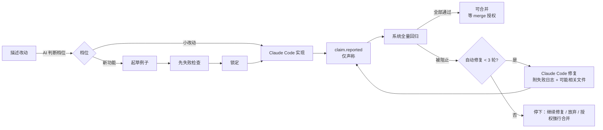

# Claude Code 驱动：实现、修复、起草例子与先失败检查（M3-1、M3-2）

对应规格 §5.1、§5.2、§6（费用上限）、§8 与 tasks.md 的 SDK 调研、M3-1、M3-2。代码：`src/agent/`（适配器）、`src/server/flows/agent-flow.ts`、`src/server/flows/examples-flow.ts`。

## SDK 合同（调研结论）

见 [spec.md §8](spec.md) 的 spike 结论表。类型合同在 `spikes/agent-sdk/contract.ts`（`npm run typecheck` 会编译它），真实调用脚本 `spikes/agent-sdk/live.mjs` 需要已登录的 Claude Code；2026-10-16 已真实运行，并在 stagent 自身上做了一次完整试用（扫描、基线、新功能、守卫探测），结果见 [trial.md](trial.md)。

## 适配器 `AgentExecutor`

| 方法 | 用途 | 权限 |
|---|---|---|
| `classifyChange` | 判断档位、目标功能、是否建议拆成计划 | 只读（`dontAsk` + Read/Grep/Glob） |
| `draftPlan` | 需求 → 2–8 个有序步骤（M4-4） | 只读 |
| `attributeFiles` | 改动文件 → 功能归属（M4-3） | 只读 |
| `draftExamples` | 新功能例子 / 基线例子 / 重写一条检查 | `acceptEdits`，不给 Bash；守卫只对本会话放行 `.stagent/checks/draft/**` |
| `implement` / `fix` | 实现与修复 | `acceptEdits` + Bash（守卫拦危险命令与 `.stagent/**`） |
| `answerDecisionQuestion` | 决策卡「我有疑问」 | 只读 |
| `scanFeatures` | 接入扫描（每行 `FEATURE {...}` 即回调，流式返回） | 只读 |
| `draftRecords` / `draftRule` | 记录卡与规则提案（M5-1） | 只读 |

- `ClaudeCodeExecutor`（`src/agent/claude-code.ts`）：`query({ cwd: 项目根, settingSources: ['project'], … })`，回报按固定格式（改了什么 / 取舍 / 例子）解析；解析失败原文入库并标「回报格式异常」。
- `ScriptedExecutor`（`src/agent/scripted.ts`）：按脚本改文件、按固定格式回报，不调用模型。全部测试与 `npm run demo` 用它。
- 不可用（未安装 SDK、未登录、`STAGENT_AGENT=off`）时，起草 / 实现 / 修复 / 扫描按钮禁用并写明原因与解决命令；外部改动流程照常可用。

## 实现与自动修复循环

- **Invariant 1**：AI 的回报只写 `claim.reported`（带 `round`：0 实现、n 第 n 轮修复）；"已验证"只能来自执行器的 `run.completed`。回报说"已实现"但检查 errored → 「仅 AI 声称」；claim 与 failed 并存时显示失败、claim 保留在时间线。
- 小改动从描述到「可合并」不需要任何人工确认（文件归属由 AI 自动给出），合并仍需一次 merge 授权（验收 #10）。
- 外观不满意（附说明）会带着说明交给 Claude Code，**不计入** 3 轮上限。
- 同一时间最多一个 AI 任务（`overview.agent.task`，SSE `agent.progress` 推一行状态，日志可展开）。记录卡起草与文件归属是只读小任务，不占任务槽。

## 费用上限

- 每次调用的 usage（provider / model / inputTokens / outputTokens / estimatedCost）写入 `~/.stagent/projects/<id>/usage.jsonl`，不进事件链。
- 达到 `config.budget.perChange` 或 `perDay` 时拒绝开始新的 AI 任务（402），循环在两轮之间停下；剩余额度作为 `maxBudgetUsd` 传给 SDK。结论卡出现「提高上限（需授权）」→ `budget_raise`（`auth.granted.amount`，带 changeId 的提高本改动上限，同时提高当日上限）。

## 实现中断

实现 / 修复进行中会写 `.stagent/runs/agent-task.json`（含 SDK 会话 id）。服务启动时发现它 → 写 `change.interrupted`，结论卡给出「续接 Claude Code 会话」（`options.resume`）/「重新发起（携带例子与日志）」/「放弃改动」。

## 起草例子与先失败检查（M3-2，Invariant 7）

1. 新功能档建改动后，Claude Code 在 `.stagent/checks/draft/<changeId>/` 写检查，并给每条例子一句大白话摘要（`example.drafted.summary`）。
2. 你确认后 `POST /api/changes/:id/red-check`：执行器对草稿内容跑一次 `purpose: 'red_check'`，每条结果记录所跑内容的哈希。**只有 failed 合格**。
3. 不合格的例子出现决策卡：让 AI 重写（重写后自动再跑先失败检查）/ 确认行为已存在（`example.red_waived`，原因 ≥ 4 字，只对当前内容哈希有效，进交付报告）/ 删掉（`example.discarded`）。
4. 锁定 `POST /api/changes/:id/examples/lock`：新功能档每条例子必须有「同一内容哈希」的合格先失败检查或豁免，否则 **422**；草稿移到 `.stagent/checks/<功能>/` 下，先写快照再写 `example.locked { redCheck }`。手写例子（`POST /api/changes/:id/examples`）同样适用。
5. 先失败检查的 run 不参与例子状态判定，也不让任何功能变成被破坏。

决策卡（`DecisionCard`）都带「我有疑问」：`POST /api/decisions/:cardId/ask` 由 `answerDecisionQuestion` 回答。

## 接口

| 方法 | 路径 | 说明 |
|---|---|---|
| POST | `/api/changes` | AI 判断档位；建议拆成计划时返回 `{ suggestPlan: true, rationale }`，带 `force: true` 坚持单个改动 |
| POST | `/api/changes/:id/draft` · `/implement` · `/fix` · `/resume` | 起草例子 / 实现 / 修复 / 续接（202，后台） |
| POST | `/api/agent/cancel` | 停止 Claude Code |
| POST | `/api/changes/:id/red-check` | 先失败检查，返回每条例子的结果 |
| POST | `/api/changes/:id/examples/:exampleId/red-waive` · `/rewrite` · `/discard` | 豁免 / 重写 / 删除 |
| POST | `/api/decisions/:cardId/ask` | 决策卡追问 |

## 推断与待规格确认

- AI 判断档位在建改动时同步进行（失败不阻止建改动）；建好后自动开始（小改动 → 实现，新功能 → 起草），`ServiceOptions.autoAgent=false` 可关闭。
- 「最多自动 3 轮」理解为每次（自动或你点击）发起的修复链最多 3 轮；你点「继续修复」开始新的一链。
- 新功能档的例子挂在以需求命名的新功能上；计划步骤指定了已有功能时挂到该功能。
