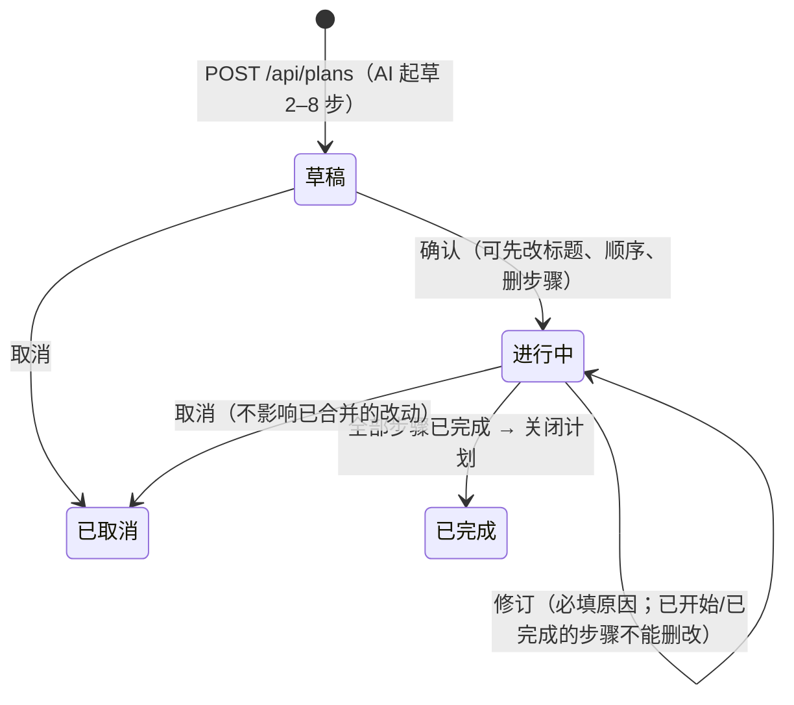

# 需求计划（M4-4）

对应规格 §4.4、§5.5、D28 与 tasks.md 的 M4-4。代码：`src/plans/plans.ts`（投影）、`src/server/flows/plan-flow.ts`、`web/src/pages/PlansPage.tsx`。

- `POST /api/changes` 时 AI 判断需求会触及 ≥ 2 个功能（或需要 ≥ 2 次独立验收）→ 返回 `{ suggestPlan: true }`，界面问你「拆成计划」还是「坚持作为单个改动」（`force: true`）。
- 步骤状态由关联改动推导：等待前置 / 可开始 / 进行中 / 已完成（改动已合并）/ 待重做（改动被放弃）。「已完成」不代表功能当前仍为已验证，计划页同时显示功能的当前状态。
- 「开始这一步」→ `POST /api/plans/:id/steps/:stepId/start`：以步骤 intent 建改动（`change.started.planId/stepId`，`targetFeatureIds = featureIds`），之后走普通单改动流程；下一步不会自动开始。
- 计划不改变「同一时间最多一个进行中改动」；同一时间最多一个进行中的计划（第二个 409）。
- 结论卡下方显示「计划：… · 第 n/N 步 · 状态」，全部完成时提示关闭。

`plan.*` 事件字段已按 spec v2.2 对齐（`requirement`、`steps[].intent / featureIds / dependsOn`、`plan.closed.outcome`），M1-1 写的占位字段在此之前没有被写入过任何账本。
