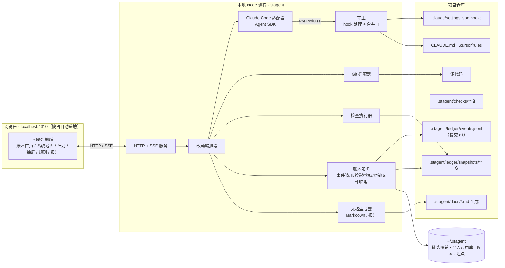
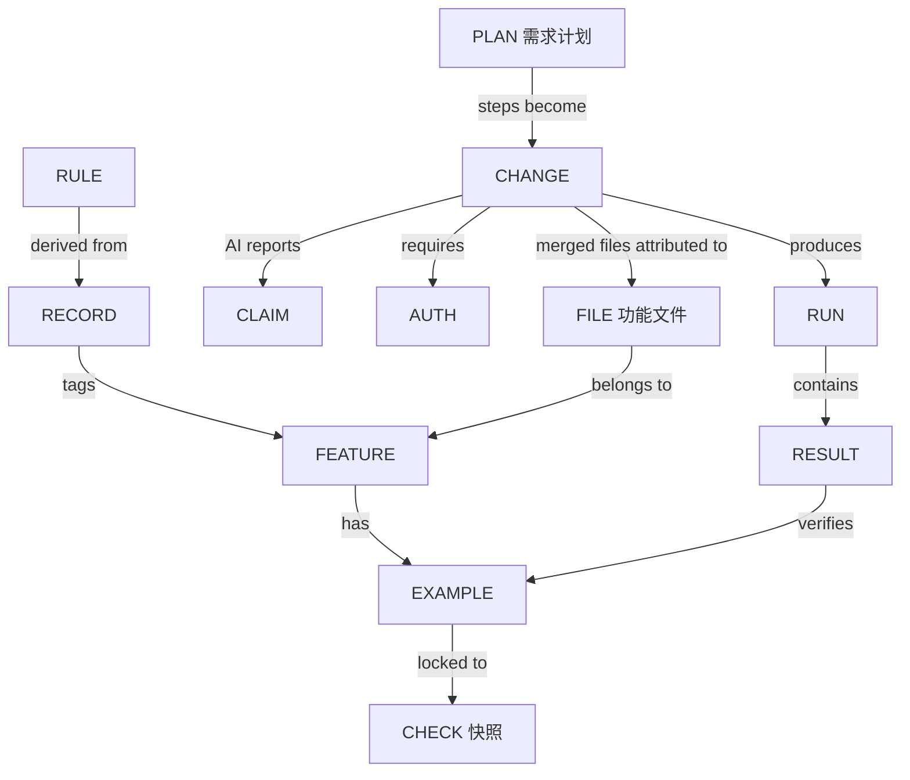
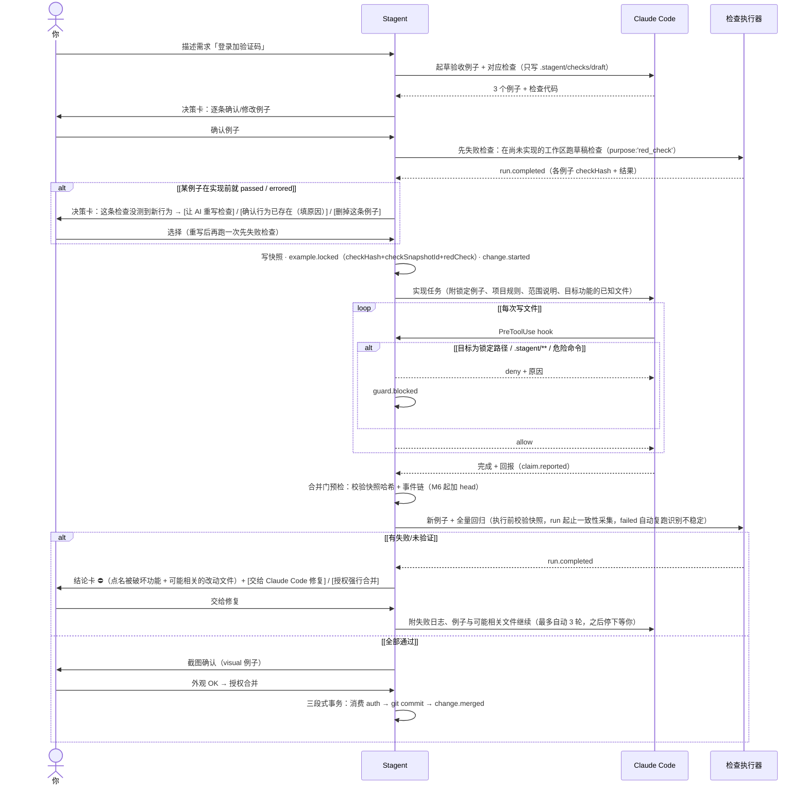
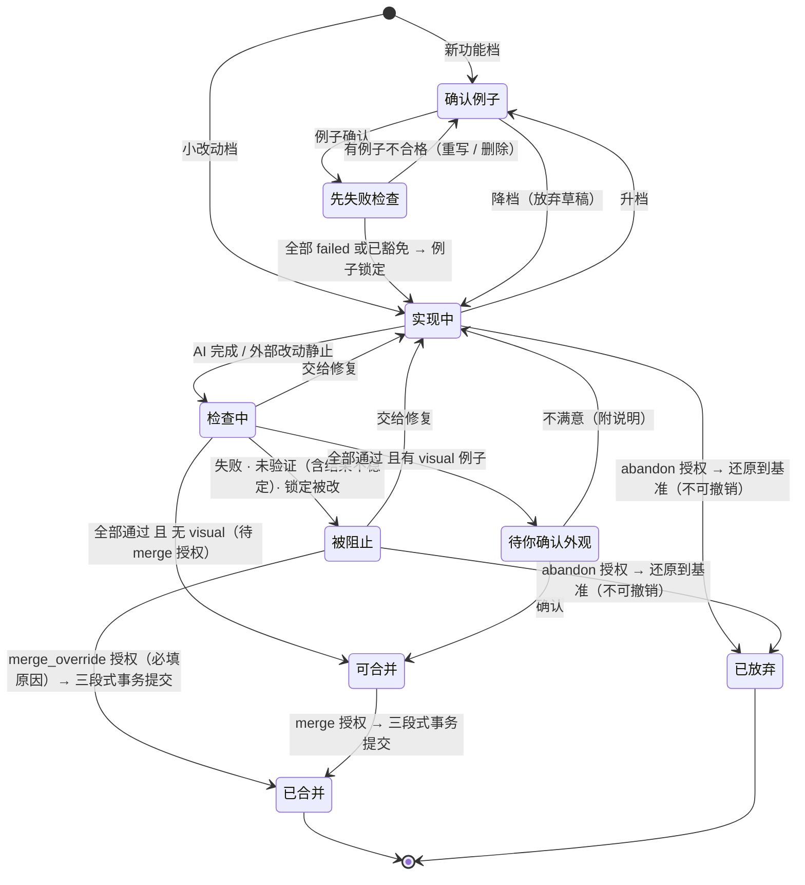

# Stagent v1 实现规格：已验收功能账本
> 一句话：Stagent 不写代码。它记住系统由哪些已验收功能组成，每个功能靠哪些锁定的验收例子和系统亲自运行的检查证明仍然成立、由哪些代码文件承载；每次改动后告诉你哪些还成立、哪些被破坏、哪些只是 AI 声称，以及改动波及了哪些功能。
>
> 更准确地说：Stagent 不负责写代码，而负责**证明**代码改动是否仍满足已验收功能，并让你**看得懂**系统由什么组成、改动落在哪里。

## 1. 目标与非目标

### 目标（v1）
- 功能账本：功能 → 验收例子（锁定）→ 检查 → 最近一次系统执行结果。
- 系统地图：功能 → 承载它的代码文件（由合并记录累积，D27）；每次改动显示波及了哪些功能。
- 两档改动流程：小改动只跑全量回归；新功能先确认例子再实现（D19），且例子必须在实现前先失败（D29）。
- 需求计划：大需求先拆成有序的多个改动，你确认计划后逐个执行、逐个验收（D28）。
- 证据只来自系统执行器：AI 的回报一律标为"仅 AI 声称"（D10）。
- 系统强制：写入锁定文件时拦截，合并前再校验（D23）；合并、放弃改动、发布、删除功能、修改锁定例子、强行合并、突破费用上限都需要你授权（D21、D22）。授权与确认的区分见 §2 术语表。
- 驱动 Claude Code 执行任务，同时识别 Cursor 或手写的改动（D2）。
- 已有项目接入：AI 扫描生成功能清单，你勾选 3–5 个核心功能补基线例子（D24）。
- 决策与踩坑记录 + 项目规则：AI 起草、你确认；重复出现的问题提炼成带失效条件的规则，写入 CLAUDE.md 和 .cursor/rules（D5–D9）。
- 外包交付报告：一页式 HTML/PDF（D26）。

### 非目标（v1 明确不做）
- 不做多 Agent 角色、团队面板、Agent 队列。需求计划（§5.5）的步骤严格串行、每步都由你启动，不是自动派发的队列。
- 不做静态分析式的依赖图或影响图（D18：回归仍是全量）。系统地图（D27）只来自"哪次改动为哪个功能改了哪些文件"的历史记录，是**提示**而不是精确的依赖关系，不用于裁剪回归范围。
- 不自动检索、注入经验。
- 不做云端、多用户、多项目并行执行（一个项目同一时间只有一个进行中的改动，互斥机制见 §5.0）。
- 不做部署流水线；「发布上线」只是一个需要授权、会被记录的动作，具体执行由用户配置的命令完成。

## 2. 用户与原则

用户：懂一点开发的独立开发者或外包工程师，主要通过自然语言驱动 AI。

人只负责两件事：确认意图（验收例子、外观截图、需求计划的步骤划分），以及授权不可逆动作。技术选型和单个改动内部的实现拆分由 AI 默认决定并说明理由，不请你确认（D16）；但跨多个改动的需求拆分要你确认，因为它决定了你验收的粒度（D28）。

界面：首屏是一张结论卡，回答"能不能继续、差什么、需要我做什么"；其余信息展开才看到（D3）。

证据状态：首屏只显示 3 种（D25）：已验证、失败、未验证。未验证展开后细分为：未执行、执行异常、结果不稳定、证据过期、证据无效、仅 AI 声称（§4.2）。

「已验证」的显示范围：界面与报告中一律写作「已验证（N 个例子）」，不得单独写「已验证」。它只表示**已锁定例子范围内**成立，例子没有覆盖的行为即使被破坏也不会被发现；覆盖薄弱的功能在结论卡原因列表中出现（§11）。

### 术语表（全文统一）
| 术语 | 级别 | 定义 |
|------|------|------|
| 失败（failed） | 例子级 | 最近一次系统运行中该例子退出码非 0 |
| 被破坏 | 功能级 | 至少一个已锁定例子处于失败状态 |
| 已验证 | 功能级 | 至少 1 个已锁定例子，且所有已锁定例子 passed、证据未过期、来源 run 有效（§4.2）。显示为「已验证（N 个例子）」 |
| 未验证 | 功能级/例子级 | 其余一切情况；细分为未执行、执行异常、结果不稳定、证据过期、证据无效、仅 AI 声称 |
| 结果不稳定 | 证据状态 | 同一 run 内对同一快照、同一工作区的多次尝试结果矛盾（先 failed 后 passed，§7） |
| 证据过期 | 证据状态 | 有 passed 结果，但其 workTreeHash ≠ 当前 workTreeHash |
| 证据无效 | 证据状态 | run 执行期间 HEAD 或工作区发生变化，该 run 整体作废（§4.1） |
| 先失败检查（red check） | 检查 | 新功能例子锁定后、实现开始前对当前工作区跑一次；必须 failed 才说明检查真的在测这个新行为（§5.1） |
| 功能文件 | 映射 | 已合并改动中、被归属到某功能的文件（§4.5）。由历史累积，只是提示，不代表精确依赖 |
| 需求计划 | 流程 | 一个大需求被拆成的、有序的多个改动步骤（§5.5） |
| 确认 | 人工动作 | 对业务意图的确认：验收例子、外观截图、需求计划、改动文件的功能归属、规则提案、记录卡、放弃改动前的影响范围。不产生授权 |
| 授权 | 人工动作 | 对不可逆动作的批准：merge、merge_override、abandon、modify_locked、delete、release、budget_raise。写入 `auth.granted`，一次性；**消费时写 `auth.consumed`（先于副作用落盘），结果写 `auth.settled`**（§6） |

## 3. 总体架构



分层说明（对应上图）

- 浏览器（localhost:4310，被占用时自动递增 4311+ 并在终端提示实际端口）：React 前端，只有六类界面——账本首页、系统地图、需求计划、详情抽屉、规则/决策提案、交付报告；所有数据都来自本地 HTTP + SSE 接口。
- 本地 Node 进程（stagent 服务）：唯一后端。同一项目同一时间只允许一个 stagent 实例：启动时检查 `~/.stagent/projects/<projectId>/service.lock`（含 pid），已存在存活实例则退出并提示。
- 关键路径：浏览器 ↔ HTTP + SSE ↔ 改动编排器 →（适配器 / 执行器）；Claude Code 的每次工具调用都要先过守卫；所有事实先追加到 events.jsonl，再投影成 UI 看到的状态。
- 项目仓库：源代码，加上 .stagent/ledger/events.jsonl（只追加，**提交 git**）、.stagent/ledger/snapshots/**（锁定检查快照，**提交 git**，🔒）、.stagent/checks/**（锁定后受保护）、.stagent/docs/*.md（自动生成）、CLAUDE.md 与 .cursor/rules（规则）、.claude/settings.json（hooks 注册）。
- ~/.stagent：仓库之外的本地数据，存放事件链的链头哈希（防篡改锚点，M6 起启用，见 §4.1）、个人通用库、配置与本地埋点，AI 的工作目录里不包含它。

### 技术栈（默认值，不再询问）
| 层 | 选择 | 理由 |
|---|---|---|
| 运行形态 | npx stagent 在项目根目录启动本地服务，自动打开浏览器（D4） | 零部署，数据随仓库走 |
| 后端 | Node 20+、TypeScript、Fastify，用 SSE 推送执行进度 | 与 Claude Agent SDK（TS）同一生态 |
| 前端 | React + Vite，静态资源打包进 npm 包 | 本地单进程 |
| AI 执行 | @anthropic-ai/claude-agent-sdk（驱动 Claude Code） | 复用成熟的执行引擎和 hooks |
| 检查运行 | 子进程执行检查命令；UI 类检查用 Playwright（含截图） | 与语言无关 |
| Git | simple-git | 基准、diff、提交 |
| 报告 | HTML 模板，PDF 用 Playwright page.pdf() 生成 | 不新增依赖 |

## 4. 数据模型

### 4.0 核心不变量

以下不变量在 M1–M6 全部里程碑中不得破坏，违反任意一条即视为缺陷：

- **Invariant 1**：不存在任何路径可以由 AI claim 直接产生「已验证」。
- **Invariant 2**：不存在任何 UI/API 可以直接把功能状态写成「已验证」。
- **Invariant 3**：任何「已验证」状态必须可追溯到一个**有效**的 `run`；该 run 必须持久化起止四个值（`observedHeadStart/End`、`workTreeHashStart/End`）、绑定当前有效的 `checkSnapshotId` 集合；run 开始至结束期间 HEAD 和纳入哈希范围的工作区不得发生变化（即 Start == End），否则该 run `valid=false`，不得作为当前验证证据。
- **Invariant 4**：修改锁定检查后，旧 run 仍然保留，但不得继续作为当前验证证据。
- **Invariant 5**：所有来源（Claude Code / Cursor / 手写）的合并必须经过服务端合并门（§6）；Git hooks 只是提醒，不是边界。
- **Invariant 6**：任何授权动作必须遵循「**消费授权 → 执行副作用 → 落账结果**」三段式协议（§6）。`auth.consumed` 必须**先于**副作用落盘，使授权在副作用发生前即不可重放；结果由 `auth.settled` 记录。授权不得被并发重复消费。
- **Invariant 7**：新功能档的例子，只有在锁定前对同一检查内容记录了一次 failed 的先失败检查（或你填写原因豁免，§5.1），才允许锁定；先失败检查的 run 不参与例子状态判定，不产生任何验证证据。
- **Invariant 8**：功能文件映射（§4.5）只用于展示、提示和给 AI 提供上下文，不参与任何证据状态推导，也不缩小回归范围；映射错误最多导致提示不准，不能导致"已验证"。

### 4.1 只追加的事件记录（唯一真相，D14）

文件：`.stagent/ledger/events.jsonl`，每行一个事件，**提交 git**。

**链格式版本**：首行必须是 meta 事件：

```json
{"type":"ledger.meta","ledgerVersion":3,"hashAlgorithm":"sha256","canonicalization":"jcs-rfc8785"}
```

**哈希算法**：每个事件包含 `hash = sha256(prevHash + canonicalJSON(event))`。
`canonicalJSON` 采用 RFC 8785（JCS）：对象键按 UTF-16 码元排序、数字按 ECMAScript Number::toString 序列化、无空白、UTF-8 编码。计算时 `event` 不含 `hash` 字段本身，禁止加入其它规范外字段。`prevHash` 为上一行事件的 `hash`，meta 行的 prevHash 为空字符串。

**完整性防护分期（v2.2）**：v1 的主要威胁是 AI **无意**改动测试或绕过检查，这由守卫、快照哈希与合并门覆盖；"有人刻意伪造整本账本"是次要威胁。因此分两期实现，账本格式从第一天起不变，后期不需要迁移：

| 能力 | M1–M5 | M6 |
|---|---|---|
| 每个事件写 `hash`、启动重算整条链（规则 1、2、2a） | ✅ | ✅ |
| 链断裂 → 🔒，可选「我确认，接受当前状态」（`ledger.integrity_override`） | ✅ | ✅ |
| 仓库外链头锚点 `~/.stagent/projects/<id>/head` 与 `head.tmp` 原子写入协议 | — | ✅ |
| 启动规则 3–7：崩溃恢复、追加攻击检测、TOFU、从 git 历史恢复 | — | ✅ |

M1–M5 的追加协议简化为：计算 `hash` → 追加事件行 + `\n` → `fsync`。这一期**不能**识别"重算了整条链的伪造账本"，界面与交付报告的「账本完整性」一栏如实写「仅校验链内一致性（未启用外部锚点）」。下文「链头哈希」「原子写入协议」与启动规则 3–7 均为 **M6** 内容。

**链头哈希（M6）**：另存一份在 `~/.stagent/projects/<projectId>/head`，不在仓库内。它是**防篡改锚点**：攻击者整体重写 events.jsonl 并重算链条时，head 对不上即暴露。head 缺失不等于账本有效——必须走首次信任确认（见下方启动规则）。

**原子写入协议（M6）**：每次追加按以下顺序执行：

1. 计算新事件的 `hash`；
2. **先将新链头写入 `head.tmp`，`fsync`**——这是「本次 append 意图」的持久化标记；
3. 追加事件行 + `\n` 到 events.jsonl，`fsync` 文件；
4. 将 `head.tmp` `rename` 为 `head`（原子替换），`fsync` 目录。

顺序要点：`head.tmp` 必须**先于**事件落盘，使「链比 head 长」这一状态**只有在本次 append 真实发生时才会被观察到**。缺少 `head.tmp` 佐证的链增长一律按外部追加处理（启动规则 5）。

**启动校验与恢复规则**：
1. meta 行的 `ledgerVersion` 不等于本版本支持的版本号 → **拒绝启动**并提示（v1 不做自动迁移，也不允许旧版本账本继续写入）；
2. 从 meta 行重算整条链，链本身不合法 → 🔒 账本被修改；唯一例外见下方「接受当前状态后的链校验」；
2a. 文件最后一行没有结尾 `\n` 且无法解析为 JSON → 视为崩在追加中途、该事件从未落账：截掉这半行并记入日志（不写事件），再按其余规则继续；
3. （M6）链合法且重算链头 == 本地 head → 正常；若残留 `head.tmp`，删除之（说明上次 append 未发生）；
4. （M6）链合法、head 是链上某个历史事件（head 落后），且 **`head.tmp` 存在且内容 == 链尾哈希** → 判定为崩溃恢复（崩在 append 与 `head.tmp` rename 之间）：完成 `rename`、写 `ledger.head_recovered`，不锁定；
5. （M6）链合法、head 落后，但 **`head.tmp` 不存在或 ≠ 链尾哈希** → 无法用单次崩溃解释（可能是外部追加了伪造事件，而锚点从未见证过它们）→ 进入规则 7 的完整性冲突流程（🔒）；
6. （M6）本地 head 缺失（新机器、被删除）→ 重算链头后弹出确认卡「无法核对历史锚点，请确认当前账本可信」，你确认后写入 `ledger.trust_established`（TOFU）并建立 head——**失去证明能力后的首次信任，必须人工确认，不自动接受**；
7. （M6）head 与链上任何事件都对不上 → 🔒 账本被修改（**检测到完整性冲突**），两个选项：
   - 「从 git 历史恢复 events.jsonl 与 snapshots/ 后重算」→ 写 `ledger.restored`；**恢复出的是一条更短的合法链**，故写该事件时按上述原子写入协议把 head 一并前移到追加后的新链头，使恢复后 head 与链重新一致，不再回落到本条；
   - 「我确认，接受当前状态」→ 写 `ledger.integrity_override`（**语义：用户接受了一个无法证明完整性的当前状态**，交付报告中必须显式标注，不得表述为"恢复"）。

**链断裂时的选项**：M1–M5 只有「我确认，接受当前状态」一个选项（以及手动用 git 还原文件后重启）；M6 增加「从 git 历史恢复」。

**接受当前状态后的链校验**：v2.1 未说明接受之后链仍是断的、下次启动会再次 🔒。v2.2 规定 `ledger.integrity_override` 携带 `prefixSha256`（该事件之前 events.jsonl 全部原始字节的 sha256）与 `brokenLinks`（断裂处的行号列表）。启动校验遇到断裂时，若其后存在一条 `ledger.integrity_override`，且该事件之前文件字节的 sha256 等于其 `prefixSha256`、断裂行号都在其 `brokenLinks` 中，则视为已被你接受，继续向后校验；override 事件自身的 `prevHash` 取它前一行的 `hash` 原值。被接受之后再出现的新断裂照常 🔒。

**孤儿快照清理**：锁定时先写快照文件再追加 `example.locked` 事件。若快照已写而事件未落账（进程崩溃），该快照不被任何事件引用——启动校验时扫描 `snapshots/` 并删除无引用快照，删除动作记入日志（不写事件，因账本未信任该快照）。由于 `.stagent/ledger/snapshots/**` 已排除在 workTreeHash 之外（见下），该清理**不会**改变 workTreeHash，因而不会让既有证据变成不可复现的「证据过期」。

**workTreeHash 算法**：对以下文件集合中的每个条目，生成一行 `path + '\0' + entryHash + '\n'`，按 path 字典序（UTF-8 字节序）拼接后整体取 sha256：

文件集合 = 所有 git 已跟踪路径（取**工作区当前内容**，含已暂存与未暂存修改）+ 所有未被 .gitignore 忽略的未跟踪路径；**排除** `.stagent/runs/**`、`.stagent/docs/**`、`.stagent/ledger/events.jsonl`（v2.2 补：账本自身由哈希链保护；若纳入，写下 `run.completed` 这一动作本身就会让该 run 的证据立刻过期，run 期间任何事件追加也会让 run 被判无效）、`.stagent/ledger/snapshots/**`（快照身份已由事件里的 `checkSnapshotId` 单独锚定，不需要再进 workTreeHash；若纳入，启动时删除孤儿快照会改变 workTreeHash，使既有证据永久不可复现）。

**证据失效豁免（v2.2）**：另外排除匹配 `config.evidence.ignoreGlobs` 的路径。默认值只包含不影响运行行为的文档类文件：

```json
{ "evidence": { "ignoreGlobs": ["**/*.md", "**/*.mdx", "LICENSE*", "docs/**", ".cursor/rules/**", ".github/ISSUE_TEMPLATE/**"] } }
```

- 锁文件（package-lock.json、pnpm-lock.yaml 等）、配置文件、图片等静态资源**不**在默认豁免中：它们会改变运行行为或外观；
- 例外：`.stagent/checks/**` 永远不能被豁免（即使其中有 .md），以免锁定检查的工作区副本被改却不触发任何反应；
- 豁免规则本身是证据定义的一部分：`workTreeHashSpec = sha256(canonicalJSON(排序后的 ignoreGlobs))` 随每次 `run.completed` 落账。当前 spec 与 run 的 spec 不同时，该 run 的 passed 一律视为「证据过期」，防止"先放宽豁免让证据不过期"；
- 修改 `ignoreGlobs` 本身会改变 `.stagent/config.json`，config 在哈希范围内，也会让证据过期——这是预期行为。

各类型条目的 `entryHash` 定义：
| 类型 | entryHash |
|---|---|
| regular file | `sha256(文件原始字节)`，不做换行转换 |
| symlink | `sha256(UTF-8 编码的 readlink(path) 返回值)`；broken symlink 同样以 readlink 字符串计算，**不解引用目标** |
| directory | 不作为条目（仅其内容物递归进入集合） |
| submodule（gitlink） | `sha256(UTF-8 编码的 gitlink commit SHA 字符串)`；**不递归进入子模块内容** |
| 其他特殊文件（fifo/socket/device） | 不作为条目，并在计算日志中记录警告 |

**run 起止一致性**：每次 run 开始时采集 `observedHeadStart` 与 `workTreeHashStart`，结束时采集 `observedHeadEnd` 与 `workTreeHashEnd`；**四个值随 `run.completed` 一并落账**，使「哪一端发生了变化」事后可复核。二者任一不同 → 该 run `valid=false`、`invalidReason='head_changed'|'worktree_changed_during_run'`，所有结果不得作为当前验证证据（UI 显示「证据无效」），但仍落账保留。

```ts
type Event =
  | { type: 'ledger.meta'; ledgerVersion: 3; hashAlgorithm: 'sha256'; canonicalization: 'jcs-rfc8785' }
  | { type: 'feature.created'; featureId; name; origin: 'new'|'scan'; entryFiles?: string[] } // scan 时附入口文件，成为初始映射
  | { type: 'feature.retired'; featureId; reason; by: 'user'; authId }     // 需 delete 授权
  | { type: 'example.drafted'; exampleId; featureId; given; when; then; kind: 'behavior'|'visual' }
  | { type: 'example.locked'; exampleId; checkPath; checkHash; checkSnapshotId; by: 'user';
      redCheck?: { runId } | { waived: true; reason } }                  // 新功能档必填（Invariant 7）；基线与重锁可省略
  | { type: 'example.unlocked'; exampleId; reason; by: 'user'; authId }    // 需 modify_locked 授权
  | { type: 'change.started'; changeId; track: 'small'|'feature'; baseCommit; baseWorkTreeHash;
      source: 'claude-code'|'external'; observedAt?; firstObservedWorkTreeHash?;
      targetFeatureIds?: string[];                                       // 本改动意图触及的功能，用于「超出本功能的改动」（§4.5）
      planId?; stepId? }                                                 // 属于需求计划的某一步（§5.5）
  | { type: 'change.track_upgraded'; changeId; by: 'user' }
  | { type: 'change.track_downgraded'; changeId; by: 'user' }
  | { type: 'change.files_attributed'; changeId;                         // 合并前写入；可被后续同 change 的同名事件覆盖
      attributions: { path; featureIds: string[]; source: 'ai'|'user'|'target' }[] }
  | { type: 'feature.files_reassigned'; path; featureIds: string[]; by: 'user'; note? } // 在系统地图里手动纠正归属
  | { type: 'claim.reported'; changeId; exampleId?; text }                 // 来自 AI，仅为"声称"
  | { type: 'run.completed'; runId; changeId?;
      purpose: 'regression'|'red_check'|'baseline';                       // red_check 不参与状态判定（Invariant 7）
      observedHeadStart; observedHeadEnd; workTreeHashStart; workTreeHashEnd; workTreeHashSpec;
      valid: boolean; invalidReason?: 'head_changed'|'worktree_changed_during_run';
      results: CheckResult[] }
  | { type: 'plan.drafted'; planId; requirement; steps: PlanStep[] }       // AI 起草
  | { type: 'plan.confirmed'; planId; steps: PlanStep[]; by: 'user' }    // 你确认（可先修改步骤）
  | { type: 'plan.revised'; planId; steps: PlanStep[]; reason; by: 'user' }
  | { type: 'plan.closed'; planId; outcome: 'completed'|'cancelled'; reason?; by: 'user' }
  | { type: 'visual.confirmed'; exampleId; screenshot; ok: boolean; note?; by: 'user' }
  | { type: 'guard.blocked'; changeId?; path; tool; detail }
  | { type: 'auth.granted'; authId; action: AuthAction; changeId?; targetId?; reason?; grantedAt }
  | { type: 'auth.consumed'; authId; consumedAt }                     // 消费记录：先于副作用落盘，此刻授权即不可重放
  | { type: 'auth.settled'; authId; settledAt; outcome: 'success'|'failed'; detail? }  // 结果：副作用之后落盘
  | { type: 'change.merged'; changeId; mergeCommit; authId;
      files: { path; status: 'added'|'modified'|'deleted'|'renamed'; oldPath?; added; deleted }[] }
  | { type: 'change.abandoned'; changeId; reason; authId }            // 需 abandon 授权
  | { type: 'record.saved'; recordId; kind: 'decision'|'pitfall'; tags; scope: 'project'|'personal' }
  | { type: 'rule.proposed' | 'rule.accepted' | 'rule.retired'; ruleId; text; appliesWhen; expiresWhen }
  | { type: 'release.executed'; command; exitCode; by: 'user'; authId }
  | { type: 'ledger.head_recovered'; detail }                    // 崩溃恢复：head 前移（自动，无需人工）
  | { type: 'ledger.trust_established'; detail; by: 'user' }    // TOFU：head 缺失后的首次信任
  | { type: 'ledger.integrity_override'; detail; prefixSha256; brokenLinks: number[]; by: 'user' } // 接受当前状态（见上文链校验例外）
  | { type: 'ledger.restored'; detail; by: 'user' };            // 从 git 历史恢复（M6）

type PlanStep = { stepId; title; intent; track: 'small'|'feature'; featureIds?: string[]; dependsOn?: string[] };

type AuthAction = 'merge' | 'merge_override' | 'abandon' | 'modify_locked' | 'delete' | 'release' | 'budget_raise';
// merge：普通合并授权，免填原因；
// merge_override / abandon / modify_locked / delete / release / budget_raise：必须填写原因（≥ 4 个字符）。
// delete 的对象仅为「功能退役」（targetId = featureId）与「记录删除」（targetId = recordId）。
// 授权一次性：绑定 (action, changeId/targetId)，消费时写 auth.consumed（先于副作用），结果写 auth.settled（§6 三段式协议）。

type CheckResult = { exampleId; status: 'passed'|'failed'|'flaky'|'not_run'|'errored'; durationMs; logPath; screenshot?;
  checkHash?;                                                            // red_check 必填：所跑草稿检查内容的 sha256，锁定时须与 checkHash 相等
  attempts?: { status: 'passed'|'failed'|'errored'; durationMs; logPath }[] }; // 同一 run 内的多次尝试（§7）；flaky = 尝试结果矛盾
```

**锁定检查快照**：锁定时将检查文件内容复制到 `.stagent/ledger/snapshots/<checkSnapshotId>`，`checkSnapshotId = sha256(内容)` 且必须等于 `checkHash`。快照随仓库提交 git。工作区的 `checkPath` 只用于展示和检测是否被修改；执行器对已锁定例子永远从快照执行（唯一例外是锁定前的先失败检查，跑的是草稿内容，结果不作为证据，§5.1），且**每次执行前重算快照内容的 sha256 并比对 `checkSnapshotId`**（§7），合并门前同样校验（§6）。

**修改锁定例子的完整流程**：授权（modify_locked）→ `example.unlocked`（携带 authId）→ 修改 → 重新锁定（生成新快照与新 checkHash，写 `example.locked`；若修改是因为期望行为变了，决策卡默认建议先跑一次先失败检查，可跳过）→ 自动触发一次全量回归。旧快照与旧 run 保留但不再作为证据（Invariant 4）。

### 4.2 投影（内存派生，可随时从事件重建）



状态推导：

**例子级**：以**最近一次 `purpose ≠ 'red_check'` 的 `run.completed`** 为唯一判据，避免多项条件互相竞争。`valid=false` 的 run 只产生「证据无效」，不产生其它状态；`valid=true` 但使用非当前快照的 run 不参与判定。

| 最近一次 run | 判定 |
|---|---|
| 无 run，有 claim | 仅 AI 声称 |
| 无 run，无 claim | 未执行 |
| `valid=false`（执行期间 HEAD 或工作区变化） | 证据无效 |
| `valid=true`，passed，且 workTreeHash 与 workTreeHashSpec 都等于当前 | passed |
| `valid=true`，passed，但 workTreeHash 或 workTreeHashSpec ≠ 当前 | 证据过期 |
| `valid=true`，failed | failed |
| `valid=true`，flaky（同一 run 内先 failed 后 passed，§7） | 结果不稳定 |
| `valid=true`，errored | errored |

补充规则：

- **claim 与 failed 可共存，failed 优先展示**，claim 保留在时间线中（交付报告体现"AI 声称完成但系统证伪"）；
- 「证据无效」与「证据过期」都附「重新验证」入口；`valid=false` 的 run 不产生任何当前验证证据，但仍落账保留。
- 「结果不稳定」不是通过：它属于未验证，阻止普通合并；展开后显示每次尝试的日志，并给出「交给 Claude Code 让检查变稳定」入口（这类修复只能改被测代码或走 modify_locked 改检查，守卫规则不变）。

**功能级**：
- 被破坏：至少一个已锁定例子 failed；
- 已验证：至少 1 个已锁定例子，且所有已锁定例子都 passed（证据未过期、来源 run 有效）；显示为「已验证（N 个例子）」；
- 未验证：其余情况（含没有例子的功能、结果不稳定、证据过期、证据无效、仅 AI 声称、未执行、执行异常）。

**证据失效规则**：workTreeHash 变化即触发证据过期。由于排除清单（§4.1）的存在，改动 `.stagent/runs/`、`.stagent/docs/`、`.stagent/ledger/events.jsonl`、`.stagent/ledger/snapshots/` 以及匹配 `config.evidence.ignoreGlobs` 的文件（默认是 README 等文档）不会使证据过期；其余被跟踪文件（含锁文件、图片）仍会使证据过期，UI 显示「证据过期」并提示一键重跑。

覆盖薄弱：功能锁定的例子少于 2 个，或只有 visual 类例子。覆盖薄弱的功能在结论卡原因列表中出现（排在失败与未验证之后），而不只是表格里的琥珀色覆盖条。

### 4.3 目录约定

```
.stagent/
  config.json            # 检查命令、发布命令、预算、开发服务器启动命令、检查超时、证据失效豁免（evidence.ignoreGlobs）、不稳定复跑次数
  ledger/events.jsonl    # 🔒 仅 stagent 写入；提交 git
  ledger/snapshots/<id>  # 🔒 锁定检查内容快照；提交 git
  checks/<feature>/<example>.spec.ts   # 🔒 锁定后受保护（工作区副本，仅供展示与篡改检测）
  runs/<runId>/          # 日志、截图（不提交，加入 .gitignore）
  docs/                  # 生成（不提交，加入 .gitignore）
~/.stagent/
  projects/<id>/head           # 链头哈希（防篡改锚点，M6）
  projects/<id>/service.lock   # 单实例锁（pid）
  library/*.md                 # 个人通用库（D8）
  metrics.jsonl                # 本地埋点（§14），不进入事件链
```

> 注：`.stagent/ledger/**` 与 `.stagent/checks/**` 提交 git，使「从 git 历史恢复」（§11，M6）成立；守卫拦截 Claude Code 对这些路径的写入，外部篡改由哈希链 + 快照自校验兜底，M6 起再加 head 锚点。

### 4.4 需求计划投影（D28）

计划是"一个大需求 → 有序的多个改动"的容器，本身**不产生任何证据**，只负责组织和展示。

- 计划状态：草稿（`plan.drafted`）→ 进行中（`plan.confirmed`）→ 已完成 / 已取消（`plan.closed`）。同一项目同一时间最多一个进行中的计划。
- 步骤状态由关联的改动推导（`change.started.planId/stepId`）：
  | 条件 | 步骤状态 |
  |---|---|
  | 无关联改动，且 `dependsOn` 中有未完成步骤 | 等待前置 |
  | 无关联改动，前置均已完成 | 可开始 |
  | 最近一个关联改动进行中 | 进行中（显示该改动的阶段） |
  | 最近一个关联改动已合并 | 已完成 |
  | 最近一个关联改动已放弃 | 待重做（可再开新改动） |
- 计划进度 = 已完成步骤数 / 步骤总数。「已完成」只说明该步的改动已合并，不代表其功能当前仍为已验证；计划页同时显示每步涉及功能的**当前**证据状态。
- 所有步骤已完成时，结论卡提示「关闭计划」（`plan.closed(completed)`，确认动作，不需授权）。

### 4.5 功能文件映射与系统地图（D27）

目的：回答"这个功能由哪些文件承载""这次改动碰了哪些功能""这个文件属于哪些功能"。映射**只来自账本中的历史事件**，不做静态分析（D18），不参与证据推导（Invariant 8）。

**来源**（后者覆盖前者对同一路径的结论）：
1. 扫描接入：`feature.created(origin:'scan').entryFiles`（路由、页面、接口入口文件）；
2. 每次合并：`change.files_attributed` 中每个文件的 `featureIds`；
3. 手动纠正：`feature.files_reassigned`。

**归属如何产生**（在改动到达「可合并」前，由服务端写 `change.files_attributed`）：
- 新功能档：改动文件默认归属到本改动的目标功能（`source:'target'`）；已归属到其他功能的文件，同时保留原归属并追加目标功能；
- 小改动档 / 计划步骤 / 外部改动：AI 根据改动内容、`targetFeatureIds` 与已有映射提出归属（`source:'ai'`），**自动采用，不请你确认**（保持验收 #10：小改动到达可合并不需要人工确认）；你可以在「改了什么」视图或系统地图里随时改（`source:'user'` / `feature.files_reassigned`）；
- 无法归属的文件记为空 `featureIds`，在系统地图中进入「未归属」区。

**合并时更新**：按 `change.merged.files` 处理——`deleted` 从映射移除；`renamed` 将 `oldPath` 的归属迁到新路径；其余按 attribution 合并。每个（文件, 功能）对记录最近一次被改动的 changeId 与次数，用于排序。

**投影出的视图**：
- 功能 → 文件列表（按被改次数排序，可折叠到目录层级）；
- 文件 → 功能列表；被 ≥ 3 个功能共享的文件标为「共享热点」（改它最容易误伤）；
- 「未归属」文件数。

**影响提示**（展示用，不改变回归范围）：
- **触及的功能**：本改动 diff（基准 → 工作区）中的文件，在映射中归属的功能集合；
- **超出本功能的改动**（D20）：diff 中归属集合与 `targetFeatureIds` 不相交的文件，以及「共享热点」文件。`targetFeatureIds` 来源：新功能档 = 新建功能；计划步骤 = 步骤的 `featureIds`；小改动 = AI 在开始时根据描述给出（可为空）；外部改动 = 空（此时只显示"触及的功能"，不显示"超出"区块）；
- **失败定位**：功能 F 被破坏时，抽屉列出「F 的功能文件 ∩ 本改动 diff」作为"可能相关的改动文件"，同时作为修复提示的一部分交给 Claude Code（§8）。

系统地图同时由文档生成器写成 `.stagent/docs/system-map.md`（大白话：每个功能做什么、有几个例子、当前状态、主要文件），作为你和 AI 共同的"系统说明书"。

## 5. 核心流程

### 5.0 改动的存放形态与互斥

**存放形态**：改动直接在**当前工作区**进行（不切分支，以兼容外部工具随意编辑的现实）。`change.started` 记录 `baseCommit` 与 `baseWorkTreeHash`。
- **合并**：合并门通过后，服务端执行 `git add -A`（遵循 .gitignore）并 commit，生成 `mergeCommit`，写 `change.merged`（携带 authId 与本次提交的文件清单 `files`，用于更新功能文件映射，§4.5）。事务协议见 §6。
- **放弃（还原到基准）**：需 `abandon` 授权（必填原因）。还原前先列出受影响文件清单供你**确认范围**（确认不产生授权），确认并授权后执行 `git restore --source=<baseCommit> --worktree --staged .`，并删除本改动期间新增的未跟踪文件（清单来自改动期间守卫与文件监听的记录），按 §6 三段式协议写 `change.abandoned`（携带 `authId`）。放弃不可撤销。

**互斥**：一个项目同一时间最多一个进行中的改动（状态不在 已合并/已放弃）。
- `POST /api/changes` 在存在进行中改动时返回 409 + 当前 changeId，前端引导你先完成或放弃当前改动；
- 进行中改动存在时，文件监听发现的外部变更**并入当前改动**，不新建 external change；
- 无进行中改动时才按 §5.3 规则创建 external change。

### 5.1 新功能档



要点补充：
- 锁定时先写快照再写 `example.locked`；孤儿快照由启动清理规则处理（§4.1）。
- 「外观不满意 → 回到实现」的外观确认回路**不计入**自动修复 3 轮上限。
- 合并动作永远需要 `auth.granted(merge)`（一次点击，免填原因）；强行合并走 `merge_override`（必填原因），`merge_override` 本身即完成合并，不需再叠加一次 merge 授权。

**先失败检查（red-first，D29）**——为什么需要：你确认的是大白话例子，真正执行的是 AI 写的检查代码，你多半读不懂。如果检查什么都没测（断言写空、选错了元素、永远为真），它在实现前后都会通过，"已验证"就是假的。规则：

1. 例子确认后、锁定前，执行器从草稿复制检查内容到 `runs/<runId>/checks/` 运行，`run.completed.purpose='red_check'`，每个结果记录所跑内容的 `checkHash`；
2. **只有 failed 算合格**。passed 说明检查在新行为不存在时也能通过；errored 说明检查根本跑不起来（超时、依赖缺失），两者都不合格；
3. 不合格的例子出现在决策卡上，三个选项：
   - 让 AI 重写这条检查 → 重写后对新内容再跑一次先失败检查；
   - 确认行为已存在（必填原因 ≥ 4 字）→ `example.locked.redCheck = { waived: true, reason }`，交付报告中列出；
   - 删掉这条例子；
4. 锁定时 `example.locked.checkHash` 必须等于先失败检查记录的 `checkHash`（检查锁定后内容不再变化），否则服务端拒绝锁定；
5. 先失败检查与实现后的回归是一对：检查本身有语法错误时，先失败检查会"通过"（failed），但实现后它永远不会 passed，功能不会显示为已验证，同样会暴露出来；
6. 先失败检查的 run 不参与例子状态判定（Invariant 7），也不让任何功能变成「被破坏」；
7. 先失败检查只用于新功能档的新例子。基线例子（§9）描述的是已有行为，预期直接通过，不适用；修改锁定例子后的重锁可选（§4.1）。

### 5.2 小改动档

你描述改动。AI 判断档位：只要会新增或改变用户可见行为，就判为新功能档。你可以一键升档（`change.track_upgraded`），误判为新功能档时也可以降档（`change.track_downgraded`，放弃例子草稿后进入小改动流程）。

判断档位时，AI 同时根据描述和系统地图给出 `targetFeatureIds`（预计会触及的功能，可为空），用于「改了什么」视图中的「超出本功能的改动」（§4.5）。

Claude Code 实现，守卫同样生效。运行全量回归，全部 passed 即进入「可合并」——**到达此状态不需要任何人工确认**（文件归属由 AI 自动给出，可事后修改，§4.5）；最终的合并动作仍需一次 merge 授权（一次点击），不新增例子，也不需要截图确认。

### 5.3 外部工具改动（Cursor 或手写）

服务监听工作区（chokidar，防抖 2 秒）。归属规则：

- 存在进行中改动 → 变更并入当前改动（§5.0）；
- 无进行中改动且检测到变化 → 创建 `change.started(source:'external', track:'small')`，记录 `observedAt`、`baseCommit` = 当前 HEAD、`firstObservedWorkTreeHash` = 首次观察到的 workTreeHash；
- 同一 external change 在工作区回到 clean（被合并或还原）之前，后续变化持续归属同一 change，不因防抖窗口重复创建。

**责任边界声明**：external change 的目的**不是**精确还原真实开发历史，而是建立从 Stagent 第一次观察点开始的责任边界——`firstObservedWorkTreeHash` 是该 change 的第一证据点，`baseCommit` 仅表示建档时观察到的 HEAD，不承诺等于用户实际改动起点。

**HEAD 竞态**：若在 Stagent 发现变化之前用户已 `git commit`（HEAD 前进且无对应 `change.merged`），则标注 `unmanaged commit`（见下），补跑全量回归；新建的 external change 如实记录发现时的 HEAD，并在账本中标记该不确定性。

**managed / unmanaged commit 语义**：`unmanaged commit` 是中性标注，**不等于恶意或错误**——可能只是用户正常使用 Git。其后果仅为：该 commit 对应的变更没有关联的验证证据，必须补跑全量回归重新建立证据；不自动等价于失败。

写入时无法拦截，所以靠合并门的快照哈希校验兜底（D23）。如果锁定文件被改：结论卡显示"锁定检查被修改"，按钮只有「还原锁定文件」或「授权修改锁定例子」。

### 5.4 状态机（单个改动）



- 「可合并」= 证据齐全、等待 merge 授权；不代表已合并。
- 「被阻止」不能普通合并，必须 `merge_override`（必填原因）；`merge_override` 一次授权即完成合并（v2.1 的状态图画成先回到「可合并」再要一次 merge 授权，v2.2 修正）。
- 「先失败检查」只在新功能档出现（§5.1）。
- 「待你确认外观」只在有 visual 例子时出现。
- 「已放弃」由 `abandon` 授权 + 还原动作到达（§5.0），放弃不可撤销。
- 阶段转换由服务端根据事件判断。Claude Code 和前端都不能直接设置状态（Invariant 2）。

### 5.5 需求计划（大需求，D28）

**为什么需要**：一个跨多个功能的大需求（如"加会员体系"）如果只当成一次改动，就会变成一次改了几十个文件、配了 6 个例子的巨型合并，你无法逐段验收——这正是失控的起点。

**何时触发**：`POST /api/changes` 时，AI 判断需求会触及 ≥ 2 个功能，或预计需要 ≥ 2 次独立验收时，不直接开改动，而是建议「先拆成计划」。你也可以主动选择「拆成计划」，或坚持作为单个改动。

**流程**：
1. AI 只读分析需求、功能清单与系统地图，起草 2–8 个有序步骤（`plan.drafted`）。每步写清：做什么（`intent`，大白话）、档位、涉及的功能、依赖哪些前置步骤。步骤粒度标准：**每一步合并后系统都应处于可用状态，且能用 1–4 个例子验收**；
2. 决策卡展示计划：你可以改标题、合并/拆分/删除/调整顺序，确认后写 `plan.confirmed`（确认动作，不需授权）；
3. 计划页逐步显示状态（§4.4）。你点「开始这一步」→ 以该步的 intent 创建改动（`change.started.planId/stepId`，`targetFeatureIds` = 步骤的 `featureIds`），之后完全走 §5.1 / §5.2 的单改动流程；
4. 一步合并后，下一步不会自动开始——由你点击开始（非目标：不做自动队列）；
5. 执行中发现计划不合适：`plan.revised`（必填原因），已完成的步骤不能被删除或改写，只能追加或修改未开始的步骤；
6. 全部步骤完成后关闭计划；也可随时取消计划（`plan.closed(cancelled)`，不影响已合并的改动，进行中的那一步按普通改动处理）。

**与互斥的关系**：计划不改变"同一时间最多一个进行中改动"（§5.0）。计划只决定下一个改动做什么。

## 6. 守卫与合并门（系统强制，D23）

**安全边界声明**：Git hooks（`.claude/settings.json` 的 PreToolUse、`.git/hooks/pre-merge-commit`）只是 UX 提醒与辅助保护，**可以被绕过，不构成安全边界**。唯一强制边界是**服务端合并门**：合并按钮在服务端重算所有锁定快照哈希、校验事件链（M6 起加 head），全部通过才允许合并；任何来源（Claude Code / Cursor / 手写 / git CLI）都不例外（Invariant 5）。

| 层 | 实现 | 覆盖对象 |
|---|---|---|
| 写时拦截 | stagent init 在 .claude/settings.json 写入 PreToolUse hook：stagent hook pre-tool-use。读取 stdin 的工具调用，遇 Write/Edit/MultiEdit 目标落在 .stagent/**、锁定检查路径，或 Bash 命令命中危险规则（附录 B）时返回 deny 并给出原因。唯一例外（v2.2 补，v2.1 与 §8 的起草要求矛盾）：改动处于「确认例子」阶段、且当前 Agent 会话是 `draftExamples` 时，允许写 `.stagent/checks/draft/**`；其它阶段该目录同样拒绝 | Claude Code |
| 合并门 | 合并前服务端重算快照哈希 + 校验事件链（M6 起加 head） | 所有来源（唯一强制边界） |
| 执行器隔离 | 检查运行使用 example.locked 对应的快照内容；**每次执行前重算快照 sha256 比对 checkSnapshotId**，不匹配则拒绝执行并按「锁定检查被修改」处理 | 所有来源 |
| Git hook 提醒 | v1 默认把 .git/hooks/pre-merge-commit 设为提示用户使用 Stagent（不强制，可关闭，可用 --no-verify 绕过） | 外部（仅提醒） |
| 费用上限 | 以 Agent SDK 返回的 usage 为准（provider/model/inputTokens/outputTokens/estimatedCost 记入内部数据）；达到 config.budget.perChange 或 perDay 时暂停并显示授权卡（budget_raise） | Claude Code |

**授权事务三段式协议**（Invariant 6）：所有授权动作（merge / merge_override / abandon / modify_locked / delete / release / budget_raise）统一按以下协议执行，由服务端**对每个 changeId 串行化**（进程内互斥锁；并发请求对同一授权排队，后到者在授权已消费时返回 409）：

1. **消费**：在账本写锁内完成——校验链（M6 起加 head）、快照哈希、当前状态；确认授权存在且未消费；**先追加 `auth.consumed`**（此刻授权即失效，杜绝重放），再进入步骤 2；
2. **副作用**：执行实际操作（git add+commit / 还原工作区 / 运行发布命令 / 解锁等）；
3. **落账**：追加结果事件（`change.merged` / `change.abandoned` / `release.executed` 等，携带 `authId`）与 `auth.settled(outcome:'success'|'failed', detail?)`。

顺序不可颠倒：`auth.consumed` 必须先于副作用落盘。若允许副作用先行，则崩溃窗口内授权在账本上仍是「未消费」，可被重放——对 `release` 意味着发布命令被执行两次，而发布不可回滚。

失败补偿：
- **副作用失败**（如 git commit 冲突）：追加 `auth.settled(outcome:'failed')`；授权已消费、不可复用，改动保持原状态，结论卡给出原因与「重新授权」入口；
- **悬挂消费**（有 `auth.consumed` 但无 `auth.settled`，即崩在步骤 2 或 3）：启动时列出悬挂项并提示补登记，**不自动重试副作用**（对 release 这类不可回滚动作尤其重要，v1 不做自动回滚）；
- **副作用成功但落账崩溃**：半行事件由启动规则 2a 截掉；M6 起 head 前移由启动崩溃恢复规则覆盖（§4.1 规则 4）；若副作用是 git commit 而 `change.merged` 未落账，启动时检测到 HEAD 前进无对应事件，按 unmanaged commit 规则处理并提示你补登记；
- **发布命令已执行但 `release.executed` 未落账**：同上（悬挂消费），启动时提示补登记。

**危险命令定位**：Bash 规则匹配是**风险检测器**，不是沙箱——无法识别间接调用（脚本内部删除、shell 替换、git alias）。真正的防线是：Agent SDK 权限模式 + PreToolUse + 合并门 + 授权模型。默认规则清单见附录 B，可通过 config 扩展。

需授权的动作（D22）：merge、merge_override、abandon、modify_locked、delete、release、budget_raise。普通 merge 免填原因；其余动作必须填写原因（≥ 4 个字符），写入 auth.granted，并出现在决策记录和交付报告里。

## 7. 检查执行器

每个例子对应一个检查，由 config.json 里的 checkCommand 模板决定怎么运行。默认 npx playwright test {path}，也支持 vitest、pytest 或自定义命令。

每次 run 带 `purpose`：`regression`（全量回归，默认）、`baseline`（接入时的基线，§9）、`red_check`（新功能先失败检查，§5.1，跑的是草稿内容而非快照，只跑本次新例子）。

执行隔离：运行前将快照内容还原到 `.stagent/runs/<runId>/checks/` 下执行，不使用工作区副本。**还原后立即重算快照源文件的 sha256 并与 `checkSnapshotId` 比对**；不匹配则该例子记 errored，结论卡按「锁定检查被修改」处理。

**run 一致性采集**：run 开始时记录 `observedHeadStart` 与 `workTreeHashStart`，结束时记录 `observedHeadEnd` 与 `workTreeHashEnd`；**四个值全部随 `run.completed` 落账**，使事后可复核「是 HEAD 变了还是工作区变了」。任一不同则 `run.completed.valid=false` 并附 `invalidReason`。valid=false 的 run 不产生任何当前验证证据（§4.2）。

运行前按 config.devServer 启动应用，等健康检查 URL 返回 200（超时 60 秒算 errored）。

单个检查超时：默认 120 秒（config.checkTimeoutMs 可配），超时归 errored。

结果映射：退出码 0 → passed；非 0 → failed；超时、启动失败、依赖缺失 → errored；被跳过或尚未运行 → not_run。

**不稳定识别（v2.2）**：浏览器类检查经常时好时坏，若不处理，结论卡会频繁误报「不能合并」，你很快就不再相信它。规则：
- 回归 run 中某例子 failed 时，在同一 run 内对同一快照自动复跑，最多 `config.flakyRetries` 次（默认 2）；每次尝试记入 `attempts`；
- 所有尝试都 failed → `failed`；出现过 passed → `flaky`（结果不稳定，属未验证，§4.2）；
- **不会**把"重跑后通过"当成通过：flaky 阻止普通合并，只能修复或 `merge_override`；
- 同一例子在最近 10 次回归中 flaky ≥ 2 次时，在功能表上标「不稳定检查」，结论卡建议修复检查（走 modify_locked）或修复被测代码中的竞态；
- 复跑只针对 failed；errored 仍按下文重试 1 次；先失败检查（`red_check`）不复跑——实现前的检查本来就应该失败。

全量回归：每次进入「检查中」都运行所有已锁定例子。v1 不做选择性运行。如果单次超过 5 分钟，UI 会提示并给出耗时最长的检查。

visual 例子：Playwright 截图保存到 runs/<id>/，在抽屉里等你确认，确认后写入 visual.confirmed。视觉确认回路不限次数、不计入自动修复 3 轮上限（§5.1）。

errored 默认自动重试 1 次。`valid=false` 的 run 不计入重试次数，自动重新发起一次完整 run。

## 8. Claude Code 适配器

**适配器接口**：核心账本不直接依赖 Claude。所有 AI 执行能力收敛到接口：

```ts
interface AgentExecutor {
  draftPlan(input): Promise<DraftedPlan>;                 // v2.2：需求 → 有序步骤（§5.5），只读
  attributeFiles(input): Promise<FileAttribution[]>;      // v2.2：改动文件 → 功能归属（§4.5），只读
  draftExamples(input): Promise<DraftedExamples>;
  implement(input): Promise<Claim>;
  fix(input): Promise<Claim>;
  answerDecisionQuestion(input): Promise<string>;
}
```

Claude Code 是该接口的第一个实现；未来 Cursor/其他 Agent 实现同一接口即可接入。v1 中 Cursor 只作为"外部改动"被识别（§5.3），不能由 Stagent 驱动；习惯用 Cursor 的用户可以继续用 Cursor 写代码，Stagent 只负责检查与合并门。

使用 Agent SDK 的 query()，cwd 为项目根目录，权限模式为 acceptEdits；hooks 由项目的 settings 生效。

**SDK 合同 spike（M3 前置）**：以下第三方合同必须在 M3 开工前以 spike 固化，不允许凭假定实现：hook input/output schema、permission mode 行为、工具拦截粒度、**会话 resume 能力**（若 SDK 不支持 resume，降级为放弃当前会话并携带锁定例子与日志重新发起）、cost/usage 字段、流式事件 schema。spike 结论回填本节后才冻结 M3 设计。

> **spike 结论（@anthropic-ai/claude-agent-sdk 0.3.301，内置 Claude Code 2.1.301，2026-10-16；`spikes/agent-sdk/`）**
>
> | 合同 | 结论 |
> |---|---|
> | hook input | PreToolUse 的 stdin 带 `session_id`、`cwd`、`hook_event_name`、`tool_name`、`tool_input`、`tool_use_id`；Write/Edit/MultiEdit 的目标在 `tool_input.file_path`，Bash 在 `tool_input.command` |
> | hook output | 拒绝：stdout 输出 `{"hookSpecificOutput":{"hookEventName":"PreToolUse","permissionDecision":"deny","permissionDecisionReason":"…"}}`，原因会给到 Claude；放行：不输出 |
> | hook 生效方式 | `query()` 传 `settingSources: ['project']` 才会读项目 `.claude/settings.json` 的 hooks；不传则 SDK 不加载任何文件系统设置 |
> | permission mode | `acceptEdits` 自动接受文件编辑；`dontAsk` 不弹确认，未在 `allowedTools` 里预先允许的工具一律拒绝（只读任务用它 + 只读工具） |
> | 工具拦截粒度 | 按工具名（`allowedTools` / `disallowedTools`）+ PreToolUse 按单次调用；起草例子会话用 `disallowedTools: ['Bash']` |
> | 会话 resume | 支持：`options.resume = <session_id>` 续接；因此「实现中断」优先续接，失败再携带锁定例子与日志重新发起 |
> | cost/usage | `result` 消息的 `total_cost_usd`（估算）、`usage.input_tokens/output_tokens`、`modelUsage` 的键为模型名；`options.maxBudgetUsd` 超出时 `subtype = 'error_max_budget_usd'` |
> | 流式事件 | `system/init` → `assistant`（content 里有 `text` / `tool_use` 块）→ … → `result`；大多数消息带 `session_id` |
>
> 类型合同由 `spikes/agent-sdk/contract.ts` 固定（`npm run typecheck` 会编译它，SDK 升级后合同变化即编译失败）；真实调用验证脚本 `spikes/agent-sdk/live.mjs` 需要已登录的 Claude Code，未在 CI 中运行。

起草计划时用的提示：需求原文、功能清单与系统地图摘要（`.stagent/docs/system-map.md`），要求输出 2–8 个步骤，每步满足"合并后系统可用、1–4 个例子能验收"，并说明拆分理由。

起草例子时用的提示：先给出需求原文、功能清单摘要，再要求 AI 用"情况 → 操作 → 期望"的格式写 3–6 个例子和检查代码，只能写到 .stagent/checks/draft/。提示中明确：检查必须在新行为**尚未实现**时失败（将经过先失败检查，§5.1），并为每条检查附一句大白话摘要"这条检查实际在看什么"。先失败检查不合格要求重写时，附上该检查在未实现状态下通过的日志。

实现任务时用的提示：锁定例子的原文（检查路径只读）、项目规则、"不要修改 .stagent/ 和测试检查"的说明、目标功能在系统地图中的已知文件（作为"从哪里入手"的提示，不限制改动范围）、上一轮失败日志；修复任务另附「可能相关的改动文件」（§4.5 失败定位）。最后要求按固定格式回报（改了什么、做了哪些取舍）。回报解析成 claim.reported（解析失败时原文入库并在 UI 标记"回报格式异常"），也作为决策和踩坑记录的素材。

流式消息通过 SSE 推到前端的「进行中」区域，只显示一行状态和展开日志，不展示 Agent 内部细节。

自动修复最多 3 轮。超过后停下，结论卡给出「继续修复 / 放弃改动 / 授权强行合并」三个选项。

## 9. 项目接入（D24）

1. 运行 npx stagent init：
   - 写入 .stagent/（含 ledger/meta 行）、hooks 和 .gitignore；
   - 检测技术栈，生成 config.json 草稿（开发服务器命令、检查命令）；
   - 为本项目生成 projectId（M6 起并在 ~/.stagent 中初始化链头）。
2. 「扫描功能」：Claude Code 只读扫描路由、页面和接口，输出功能清单，每个功能用 feature.created(origin:'scan', entryFiles) 记入账本，全部标为 未验证；`entryFiles` 成为系统地图的初始映射（§4.5），其余文件进入「未归属」，随后续改动逐步归属。扫描误识别的功能可退役（feature.retired，需 delete 授权）。
3. 引导你勾选 3–5 个核心功能，AI 为它们起草基线例子。**基线例子在锁定前处于草稿态，可自由修改无需授权**；你确认后锁定（写快照 + example.locked），并跑一次基线（`purpose:'baseline'`；基线例子描述已有行为，不做先失败检查）。

   基线失败不会自动改代码。结论卡说明"现有行为与例子不一致"，三个选项：
   - 修改例子（锁定前直接改草稿；已锁定则走 modify_locked 授权解锁流程，§4.1）；
   - 作为新改动去修复（新建 change）；
   - 接受现状（记录一条 kind:'pitfall' 的记录，功能标注「已知不一致」，不阻塞账本，交付报告中显式列出）。

4. 其余功能留在账本里，显示为「尚无例子」和「补例子」入口。

## 10. 记录、规则与个人库（D5–D9）

触发：change.merged 之后，AI 根据回报、失败日志、授权原因起草 0–2 条记录（decision 或 pitfall，带标签：联调、接口、数据、部署、环境等），在抽屉里显示为记录卡，你可以保存、修改或不记录。

规则提案：同一标签的 pitfall 达到 2 条时，AI 起草一条规则（包含适用条件和失效条件），在账本首页显示为提案卡。确认后写入 CLAUDE.md 和 .cursor/rules/stagent.mdc 中由 `<!-- stagent:rules -->` 哨兵标记包裹的区块（标记必须以代码格式写入文档与实现，避免被 Markdown 渲染吞掉）。

规则区块完整性：服务启动时校验该区块是否与最近一条 rule.accepted 一致；被你手动修改过时提示「规则区块已偏离账本」，可选「以账本为准重新生成」或「保留现状」。

度量：每条规则统计生效后同标签 pitfall 的数量。连续 10 次改动没有起作用，或者满足失效条件时，提示是否退役（rule.retired）。

个人通用库：勾选「同步到个人通用库」的记录或规则，会复制到 ~/.stagent/library/。新项目接入时，会列出匹配当前技术栈的规则供你挑选（技术栈标签来自 init 检测结果）。

文档生成器在每次相关事件之后重新生成 .stagent/docs/*.md，至少包括：`features.md`（功能与例子原文）、`system-map.md`（系统地图，§4.5）、`plan.md`（进行中的需求计划，§5.5）、`rules.md`。这些文档是给你读、也是给 AI 读的"系统说明书"，不进 git、不影响证据（§4.1 排除清单）。

## 11. 界面（与预览一致）

顶栏：项目名、当前分支、执行器状态、今日费用和上限；导航：功能账本 / 系统地图 / 需求计划 / 改动记录 / 决策与规则 / 交付报告。

功能账本首页（D3）：

1. 结论卡（常驻）：只回答三件事：能否继续、原因列表（最多 3 条，按严重程度排序）、主操作按钮。
   - 状态有五种：✅ 系统完好、⛔ 不能合并、👀 等你确认、⏳ 检查中、🔒 账本被修改。
   - 被禁用的按钮旁边必须写出原因，例如「合并（2 失败 · 1 未验证）」。
   - 原因列表的严重程度顺序：锁定检查被修改 > 失败 > 结果不稳定 > 其它未验证 > 覆盖薄弱。✅ 系统完好时若有覆盖薄弱的功能，仍以一行灰字提示「N 个功能只有 1 个例子」。
   - 有进行中的需求计划时，结论卡下方显示一行「计划：会员体系 · 第 2/5 步 · 进行中」，点击进入计划页。
2. 拦截提醒：最近的 guard.blocked，可以关闭。
3. 统计：已验证、被破坏、未验证的功能数，以及锁定例子总数。
4. 功能表：状态点、名称、状态文字（「已验证（3 个例子）」而非单独的「已验证」）、标签（新功能 / 已验收 / 接入扫描发现 / 已知不一致 / 不稳定检查）、例子通过数、覆盖条（薄弱时为琥珀色）、功能文件数、最近验证时间。点击一行打开抽屉。
5. 规则提案卡（有提案时显示）。

系统地图页（D27，§4.5）：
- 左侧功能列表（带状态点），右侧所选功能的文件树（按被改次数排序）、它的例子、最近 5 次改动；
- 「共享热点」区块：被 ≥ 3 个功能共享的文件，以及共享它们的功能——提示"改这里最容易误伤别的功能"；
- 「未归属」区块：尚未归属任何功能的文件数与列表，可逐个或批量指定归属（`feature.files_reassigned`）；
- 搜索框：输入文件路径，显示它属于哪些功能；
- 页首固定一句说明：「此地图来自改动历史，不是代码依赖分析；用于理解和定位，不影响检查范围。」

需求计划页（D28，§5.5）：
- 需求原文、步骤列表（序号、标题、大白话说明、涉及功能、步骤状态、关联改动的阶段）、整体进度条；
- 每步只有一个主按钮：可开始时为「开始这一步」，进行中时为「查看改动」；
- 「修改计划」打开决策卡（`plan.revised`，必填原因）；「取消计划」需确认。

详情抽屉（宽 470px）：
头部显示档位和流程进度条：①确认例子 → ②先失败检查 → ③实现 → ④检查 → ⑤确认并合并（小改动档没有 ①②）。属于计划的改动，头部另显示「计划第 N 步」。
证据：本功能的例子（显示状态，可展开看原因；「证据过期」「证据无效」「结果不稳定」单独标识并附「重新验证」按钮；每条显示其先失败检查结果或豁免原因）→ 受影响的已验收例子（只列失败和未验证的，其余合并成一行"其余 N 个通过"）→ 被破坏功能的「可能相关的改动文件」（§4.5 失败定位）→ 需要你看的截图。
改了什么（D20）：基准 → 工作区、文件数和增删行数、来源；「触及的功能」列表（来自系统地图）；按功能用大白话说明，配改前改后截图；「超出本功能的改动」区块（定义见 §4.5）；文件归属（可修改）；可展开代码 diff。
授权：被阻止的、需授权的、不可用的动作，每项都写明原因和解除办法。
底部固定显示主操作。

决策卡（D17）：用于确认例子、先失败检查不合格的处理、需求计划、授权和规则提案。包含问题、背景、2–3 个选项（每个带利弊，推荐项有标签），以及「确认 / 我有疑问」。点「我有疑问」会打开一个与本卡绑定的简短对话，回答由 Claude Code 生成。

交付报告（D26）：

内容：项目名、日期、**版本四元组**（Stagent 版本 / 项目版本 / 已验证 commit / 生成时间）；功能清单，每个功能列出例子原文、最近一次系统验证的时间和结果（写作「已验证（N 个例子）」）、每条例子的先失败检查结果或豁免原因、主要功能文件；**账本完整性一栏**（M1–M5 如实写「仅校验链内一致性（未启用外部锚点）」）；已完成与进行中的需求计划；**所有授权放行记录（记录 `action` 与原因；普通 merge 免填原因，如实标注为「免填原因」，不得留空或虚构原因）**，其中 `ledger.integrity_override` 须显式标注为「用户接受了无法证明完整性的状态」，不得表述为"恢复"；未验证项清单（含「已知不一致」「结果不稳定」）；关键技术方案。

导出 HTML，并可另存为 PDF。若运行环境无 Chromium（纯后端项目未安装 Playwright 浏览器），PDF 导出降级为仅 HTML 并在报告中注明原因。

发布（release.executed）exitCode 非 0 时：结论卡显示发布失败与日志入口，发布记录进入交付报告；v1 不做自动回滚。

报告内容只来自账本投影，"仅 AI 声称"的条目会明确标出。

### 空、加载与错误状态
| 场景 | 表现 |
|---|---|
| 新项目、账本为空 | 结论卡显示"还没有任何已验证功能"，提供「扫描现有代码」和「描述第一个功能」两个入口 |
| 检查执行中 | 结论卡 ⏳，显示进度 n/N 和当前检查名，可以取消 |
| 开发服务器起不来 | 相关例子标为 errored，结论卡给出启动日志入口和「修改启动命令」 |
| Claude Code 未安装或未登录 | 新功能、修复等按钮禁用，提示安装或登录命令；外部改动流程仍然可用 |
| 费用达到上限 | 暂停，显示授权卡「提高上限 / 停止」（budget_raise） |
| 端口 4310 被占用 | 自动递增（4311+），终端与顶栏显示实际端口 |
| 已有 stagent 实例运行 | 新实例退出并提示访问已有实例地址 |
| 事件链断裂 | 全局 🔒，所有写操作禁用，显示断裂位置；「我确认，接受当前状态」（`ledger.integrity_override`，报告中显式标注）；M6 起另有「从 git 历史恢复」（`ledger.restored`，恢复后 head 一并前移） |
| 账本最后一行是半行（崩在追加中途） | 截掉半行并记日志，不锁定（§4.1 规则 2a） |
| （M6）head 对不上 | 同「事件链断裂」 |
| （M6）head 落后且 `head.tmp` == 链尾 | 崩溃恢复：自动前移 head 并写 `ledger.head_recovered`，不锁定 |
| （M6）head 落后但无可信 `head.tmp` | 视为外部追加的事件，进入 🔒 完整性冲突流程（§4.1 规则 5） |
| （M6）head 文件缺失 | 重算链头后弹出 TOFU 确认卡，确认后写 ledger.trust_established 并建立 head（不自动信任） |
| 新例子先失败检查不合格 | 决策卡：重写检查 / 确认行为已存在（填原因）/ 删除例子；不合格的例子不能锁定 |
| 检查结果不稳定 | 例子显示「结果不稳定」，阻止普通合并，展开可看每次尝试的日志 |
| 系统地图为空（刚接入、扫描未给入口文件） | 地图页提示「完成几次改动后会逐步形成」，并列出未归属文件供手动归属 |
| 账本 `ledgerVersion` 不受支持 | 拒绝启动并提示（不自动迁移，也不允许旧版本账本继续写入） |
| run 执行期间工作区/HEAD 变化 | run.valid=false，结论卡提示「检查期间工作区发生变化，证据无效」，自动重跑一次 |
| 授权副作用失败（如 git commit 冲突） | `auth.consumed` 已落账、`auth.settled(failed)`，授权不可复用，改动保持原状态，结论卡给出原因与「重新授权」入口 |
| 悬挂消费（有 `auth.consumed` 无 `auth.settled`） | 结论卡列出悬挂项并提示补登记，**不自动重试副作用**（对 release 尤其重要） |
| 服务重启时有进行中的改动 | 从事件恢复状态；Claude Code 会话中断标为「实现中断」：SDK 支持 resume 则续接，否则携带锁定例子与日志重新发起（§8 spike 确定）；也可选择放弃 |
| SSE 断线 | 前端自动重连（Last-Event-ID）；重连失败超过 3 次则全量拉取 /api/overview 校准 |
| PDF 导出环境缺 Chromium | 降级为仅 HTML 并注明原因 |

## 12. HTTP 接口（本地）

| 方法 | 路径 | 说明 |
|---|---|---|
| GET | /api/overview | 结论卡 + 统计（含悬挂授权提示） |
| GET | /api/features · /api/features/:id | 账本与详情（例子、结果、覆盖） |
| POST | /api/changes | { description, track?, planId?, stepId? } 创建改动；存在进行中改动时返回 409 + 当前 changeId；AI 判断需求应拆成计划时返回 `{ suggestPlan: true }`，前端询问后调 /api/plans 或带 `force: true` 重试 |
| POST | /api/changes/:id/red-check | 对已确认的草稿例子跑先失败检查（§5.1）；返回每条例子的结果 |
| POST | /api/changes/:id/examples/:exampleId/red-waive | { reason } 确认行为已存在，豁免先失败检查（确认动作，必填原因） |
| PUT | /api/changes/:id/attributions | 修改本改动的文件归属（写新的 `change.files_attributed`） |
| GET | /api/map · /api/map/files?path= | 系统地图投影；按文件查询所属功能 |
| POST | /api/map/files | { path, featureIds, note? } 手动纠正归属（`feature.files_reassigned`） |
| POST | /api/plans | { requirement } AI 起草计划（`plan.drafted`）；已有进行中计划时返回 409 |
| GET | /api/plans · /api/plans/:id | 计划与步骤状态 |
| POST | /api/plans/:id/confirm · /revise · /close | 确认（可附修改后的步骤）/ 修订（必填原因）/ 关闭（completed \| cancelled） |
| POST | /api/changes/:id/track | { direction: 'upgrade' \| 'downgrade' } 升档/降档 |
| POST | /api/changes/:id/examples/lock | 锁定例子（决策卡确认；新功能档要求每条例子已有合格的先失败检查或豁免，且内容哈希一致，否则 422；服务端写快照 + example.locked） |
| POST | /api/changes/:id/examples/:exampleId/unlock | 解锁锁定例子（需 modify_locked 授权；写 example.unlocked，改动后重锁生成新快照与新 checkHash） |
| POST | /api/changes/:id/fix | 交给 Claude Code 修复 |
| POST | /api/changes/:id/merge | 合并（需先获得 merge 授权；走 §6 三段式事务，服务端串行化；授权已消费返回 409） |
| POST | /api/changes/:id/abandon | 放弃改动（需 abandon 授权；先返回受影响文件清单供确认，再走三段式事务） |
| POST | /api/features/:id/retire | 功能退役（需 delete 授权） |
| POST | /api/release | 执行发布命令（需 release 授权；走三段式事务，副作用不可回滚） |
| POST | /api/auth | { action, changeId?, targetId?, reason? }；返回 authId；一次性，`auth.consumed` 落账即失效 |
| POST | /api/runs | 手动全量回归 |
| POST | /api/visual/:exampleId | 截图确认 |
| POST | /api/ledger/recover | { mode: 'accept_current' \| 'from_git' \| 'establish_trust' } 账本恢复；分别写 ledger.integrity_override / ledger.restored / ledger.trust_established（后两者 M6 起提供） |
| POST | /api/rules/regenerate | 以账本为准重新生成规则区块（§10） |
| POST | /api/decisions/:cardId/ask | 决策卡「我有疑问」追问（由 AgentExecutor.answerDecisionQuestion 生成） |
| GET/POST | /api/records · /api/rules | 记录与规则 |
| GET | `/api/report?format=html\|pdf` | 交付报告（PDF 环境不满足时降级 HTML） |
| GET | /api/events/stream | SSE：进度、守卫、状态变化；支持 Last-Event-ID 断线续传 |
| CLI | stagent hook pre-tool-use | 给 Claude Code hooks 调用 |

## 13. 验收标准（本产品自己的）

1. 在示例 Next.js 项目（≤200 个源文件）上运行 npx stagent init 和扫描，扫描任务 30 秒内创建成功并开始流式返回功能清单；锁定 3 个基线例子后能跑出结果。
2. 新功能流程：Claude Code 尝试修改锁定检查文件时被 hook 拒绝，界面出现拦截提醒，账本里有 guard.blocked。
3. 在 Cursor 中手动修改锁定检查文件后，合并按钮被禁用，并显示"锁定检查被修改"；即使删除工作区检查文件，检查执行器仍能从快照执行原检查；**快照文件本身被篡改（内容 sha256 ≠ checkSnapshotId）时执行器拒绝执行**。
4. 改动破坏某个已验收例子时，结论卡显示 ⛔，并点名受影响的功能；修复后变为可合并。
5. AI 回报"已实现"但检查 errored 的例子，显示为 未验证 → 仅 AI 声称，绝不显示为通过；claim + failed 同时存在时显示失败，且 claim 在时间线中保留。
6. 手动篡改 events.jsonl 中任意一行后，下次启动进入 🔒 状态；选择「接受当前状态」后再次启动不再 🔒，而之后再篡改其它行仍会 🔒。
7. （M6）删除 ~/.stagent/.../head 后启动：弹出 TOFU 确认卡，未经确认不建立新 head、不信任账本。
8. （M6）模拟事件写入后进程崩溃（`head.tmp` == 链尾、head 落后、链合法）：下次启动自动前移 head 并写 `ledger.head_recovered`，不进入 🔒。
9. 授权强行合并时必须填写原因，原因同时出现在决策记录和交付报告中；普通合并需要 merge 授权（免原因），授权记录写入账本。
10. 小改动档（如修改按钮颜色）从描述到**可合并**，除去 AI 和检查耗时，不需要任何人工确认；最终合并只需一次 merge 授权点击。
11. 同标签踩坑达到 2 条时出现规则提案；确认后 CLAUDE.md 和 .cursor/rules 中出现对应区块；手动篡改该区块后下次启动出现偏离提示。
12. 交付报告导出的 HTML 和 PDF 中，每个功能都有例子原文和最近一次系统验证的时间；报告头部含版本四元组；`ledger.integrity_override` 记录显式标注。
13. 升级/降档：小改动升档后回到「确认例子」；新功能降档后草稿被放弃、进入小改动流程，事件完整可查。
14. 互斥：进行中改动存在时 POST /api/changes 返回 409；外部变更并入当前改动，不新建 change。
15. 绕过测试：`git merge --no-verify` / 直接 `git commit` 后，被标注为 unmanaged commit（中性标注，不等于失败）并补跑回归。
16. **run 一致性**：检查执行期间修改工作区文件或提交 commit，该 run `valid=false`，功能不显示已验证，UI 显示「证据无效」并自动重跑。
17. **授权并发**：对同一 change 并发发起两笔 merge 请求，仅一笔成功消费授权，另一笔返回 409；账本中恰好一条 `auth.consumed`。
18. （M6）**追加攻击**：在 Stagent 之外直接向 events.jsonl 追加若干格式合法的事件（重算链条使之自洽、不动 `~/.stagent`）后启动：因无 `head.tmp` 佐证，进入 🔒 完整性冲突流程，**不自动前移 head**。对照实验：模拟 append 后崩溃（保留 `head.tmp` 且等于链尾）→ 自动恢复。
19. **放弃与发布的事务性**：放弃改动须 `abandon` 授权，`change.abandoned` 携带 authId 与原因；release 在 `auth.consumed` 落账后、命令执行前崩溃 → 重启后该授权不可再用（列为悬挂消费并提示补登记），发布命令不会被执行第二次。
20. **先失败检查**（v2.2）：新功能档中，AI 写出一条在未实现时就通过的检查（如断言恒为真）→ 该例子不能锁定，决策卡出现「这条检查没测到新行为」；选择豁免时必须填原因，原因出现在交付报告中；先失败检查的 run 不让任何功能变成「被破坏」。
21. **不稳定检查**（v2.2）：构造一条第一次失败、第二次通过的检查 → 结果为「结果不稳定」，功能不显示已验证，普通合并按钮禁用并写明原因；`attempts` 中有两次记录。
22. **系统地图**（v2.2）：连续合并 3 个分别属于功能 A、B、A 的改动后，地图中 A、B 各自列出对应文件；随后一个以 A 为目标、却改了 B 的文件的小改动，「改了什么」中出现「超出本功能的改动」并点名该文件与功能 B；该改动破坏 B 的例子时，B 的抽屉列出该文件为「可能相关的改动文件」。删除、重命名文件后映射随之更新。
23. **需求计划**（v2.2）：输入一个触及 ≥ 2 个功能的需求，系统建议拆成计划；确认后计划页显示各步状态；开始第 1 步时创建的改动带 `planId/stepId`；第 1 步合并前第 2 步（依赖第 1 步）显示「等待前置」；计划进行中时 POST /api/changes 的互斥规则不变。
24. **证据失效豁免**（v2.2）：只修改 README.md 后，已验证功能保持已验证；修改 package-lock.json 后变为证据过期；修改 `evidence.ignoreGlobs` 后所有证据变为过期。
25. **账本自身不使证据过期**（v2.2）：一次回归全部 passed 后，在不改任何源文件的情况下追加若干事件（如 guard.blocked、claim），功能仍为已验证，不显示证据过期。

## 14. 产品健康指标（防止退化）

埋点写入本地 `~/.stagent/metrics.jsonl`（不进入事件链、不提交 git）：

- 防"盖章"：例子确认时的修改率、决策卡平均停留时间。修改率接近 0 且停留时间少于 5 秒，说明在退化成"AI 帮你填表"。
- 防"任务看板化"：被破坏的功能里，由全量回归发现的比例；用户打开证据抽屉的比例。
- 真实价值：已验收功能被破坏后在合并前就被发现的次数；仅 AI 声称被系统证伪的次数；run 被判 valid=false 的次数（间接衡量证据纪律）。
- 规则价值：规则生效前后同类踩坑的复发率。
- 检查可信度（v2.2）：先失败检查的不合格率（AI 写出"空检查"的频率）、豁免率（豁免率持续偏高说明在绕过 red-first）；不稳定检查数量。
- 理解度（v2.2）：系统地图中「未归属」文件占比；用户打开系统地图、计划页的比例；大需求被拆成计划的比例与每步平均例子数。

## 15. 里程碑

| 里程碑 | 内容 | 必须额外证明 |
|---|---|---|
| M1 账本内核 | 事件链写入与链内校验（不含 head 锚点，§4.1 分期）、半行截断、integrity_override 后的链校验、快照存储与执行前自校验、投影、init、检查执行器（含 run 起止一致性采集、不稳定识别、证据失效豁免）、全量回归、首页结论卡和功能表 | **快照可复现 + 已验证可追溯（Invariant 3）**；最小闭环：锁定 → 快照 → 运行 → passed → 投影已验证 → 篡改检查 → 旧证据保留但当前验证失效；**运行期间修改工作区 → run valid=false（验收 #16）**；篡改账本 → 🔒（验收 #6）；验收 #21、#24、#25 |
| M2 强制与改动 | PreToolUse 守卫、合并门、外部改动检测、两档流程、授权三段式事务（含 abandon）、互斥 | **所有来源最终都经过服务端合并门（Invariant 5）**，含 --no-verify 绕过测试；**并发 merge 仅一笔消费授权（验收 #17）**；**放弃/发布不可重放（验收 #19）** |
| M3 Claude Code 驱动 | 起草例子、**先失败检查**、锁定、实现与自动修复循环、费用上限、SSE 进度（前置：SDK 合同 spike） | **claim 永远不能制造已验证（Invariant 1）**；**空检查不能被锁定（Invariant 7，验收 #20）** |
| M4 接入、证据与地图 | 扫描接入、基线、visual 截图确认、变更视图（业务说明 + 截图 + diff）、**功能文件映射与系统地图、影响提示与失败定位、需求计划** | **旧证据不会错误地验证新工作区（证据过期/无效规则）**；**映射不影响任何证据状态（Invariant 8，验收 #22）**；验收 #23 |
| M5 记录与交付 | 记录卡、规则提案、个人通用库、生成文档（含 system-map.md）、交付报告 | **报告只来自投影，不把 AI 声称当事实；integrity_override 显式标注；完整性一栏如实写明防护级别** |
| M6 完整性加固 | 仓库外 head 锚点、`head.tmp` 原子写入协议、启动规则 3–7（崩溃恢复、追加攻击检测、TOFU）、从 git 历史恢复 | **外部追加事件不被自动接受（验收 #18）**；崩溃恢复（验收 #8）；TOFU（验收 #7） |

**最小可用版本**：M1 + M2 完成后，配合你手写或用 Cursor 写的检查，已经能做到"AI 改坏已验收功能时合并前就被拦住"——这是"能验收"的核心价值，建议先在自己的一个真实项目上用起来，再继续 M3 之后的部分。M6 可以在有外包交付需求、需要更强的账本可信度时再做。

## 16. 已知风险与对策

- 检查质量取决于 AI 写的检查：例子确认时，同时展示检查代码的大白话摘要；新例子必须通过先失败检查（§5.1）；覆盖薄弱时在结论卡提示补例子。残余风险：先失败检查只能证明"检查对新行为敏感"，不能证明"检查测的正是你描述的行为"（例如测到了一个相近但不同的条件）。大白话摘要与你的确认仍是这一环的唯一防线。
- 系统地图不精确：映射来自改动历史，一个文件被归到某功能只说明"曾为它改过"；AI 自动归属可能出错，共享工具文件会被归到很多功能。对策：地图页明确声明它不是依赖分析（§11），映射永远不影响证据和回归范围（Invariant 8），可随时手动纠正；v2 评估用检查运行时的代码覆盖数据补充映射。
- 计划拆得不好：AI 可能拆得过细或步骤之间耦合。对策：计划必须由你确认；每步须满足"合并后可用、1–4 个例子可验收"；可随时修订未开始的步骤。
- 全量回归变慢：v1 接受这一点，超过 5 分钟提示；v2 再考虑并行运行或按功能选择性运行。
- 外部改动无法在写入时拦截：靠合并门的快照哈希校验和执行器使用快照检查来兜底。界面明确说明"Cursor 改动只在合并门校验"。
- 扫描把现有 bug 当成"应该如此"：基线例子必须由你确认才锁定；基线失败不自动修改代码。
- events.jsonl 只追加无限增长，投影全量重建的启动耗时随事件量上升：v1 接受，启动超过 3 秒时在日志提示；为 v2 预留投影快照接口（投影落盘 + 记录对应链头）。
- 危险命令规则可被间接调用绕过：规则只是风险检测器，最终防线是合并门与授权模型（§6）。
- **证据过期过敏感（product debt，非性能问题）**：workTreeHash 覆盖所有被跟踪文件。v2.2 用 `evidence.ignoreGlobs` 豁免文档类文件（§4.1），改 README 不再让全部证据过期；但锁文件、无关图片等仍会使全部功能证据过期，以「证据过期 + 一键重跑」缓解。v2 评估按功能映射细化失效范围（注意：这是证据语义的产品债务，且放宽豁免会削弱证据，不能为了"不变黄"随意加豁免）。
- **M1–M5 无法识别重写整本账本**：完整性防护分期（§4.1）后，M6 之前账本只校验链内一致性。有人重算整条链后替换 events.jsonl 不会被发现。v1 的主要威胁（AI 无意修改）不受影响，因为守卫拦截 AI 写 `.stagent/**`，且锁定检查有快照哈希；交付报告如实写明该防护级别。
- 授权副作用的不可回滚性：release 命令一旦执行无法撤销，落账失败时依赖启动补偿提示补登记（§6）；v2 评估为发布增加 dry-run 确认。
- **head 崩溃恢复的假设边界（M6）**：自动前移 head 依赖 `head.tmp` 标记，只覆盖「单次 append 的崩溃窗口」。若实现偏离原子写入协议（例如批量 append 后只写一次 head，或先写事件再写 `head.tmp`），该判定会失效，并可能把外部追加误判为崩溃恢复。实现期须以验收 #8 / #18 双向锁定这一假设。

---

## 附录 A：决策索引（D 编号）

| 编号 | 决策（一句话） |
|---|---|
| D2 | 驱动 Claude Code 为主执行器，同时识别 Cursor / 手写改动 |
| D3 | 首屏只放结论卡，其余信息展开可见 |
| D4 | npx stagent 本地启动，零部署，数据随仓库走 |
| D5–D9 | 决策/踩坑记录与规则体系：AI 起草、人确认；规则带失效条件；个人通用库跨项目复用 |
| D10 | AI 的回报一律只是"声称"，证据只来自系统执行器 |
| D14 | 只追加事件链是账本唯一真相，投影可随时重建 |
| D16 | 技术选型与单个改动内部的拆分由 AI 默认决定并说明理由，不请人确认（v2.2：跨改动的需求拆分见 D28，需确认） |
| D17 | 所有人工介入统一走决策卡（选项带利弊 + 我有疑问对话） |
| D18 | 不做静态分析式依赖图/影响图，回归始终全量；v2.2 的系统地图（D27）只来自改动历史，仅作提示 |
| D19 | 两档改动流程：小改动全量回归，新功能先定例子再实现 |
| D20 | 「改了什么」视图：业务说明 + 截图 + 可展开 diff；「超出本功能的改动」按 §4.5 定义计算 |
| D21/D22 | 不可逆动作必须授权并留痕（merge、merge_override、abandon、modify_locked、delete、release、budget_raise） |
| D23 | 系统强制三层：写时拦截 + 合并门 + 执行器快照隔离 |
| D24 | 已有项目接入：扫描 → 勾选核心功能 → 补基线例子 |
| D25 | 首屏证据状态只有三种：已验证 / 失败 / 未验证 |
| D26 | 外包交付报告：一页式 HTML/PDF，只来自账本投影 |
| D27 | （v2.2）功能文件映射与系统地图：合并时把改动文件归属到功能，累积成"功能 ↔ 文件"地图，用于理解、影响提示与失败定位，不参与证据 |
| D28 | （v2.2）需求计划：跨多个功能的大需求先拆成有序步骤、由你确认，每步是一个普通改动，逐步验收 |
| D29 | （v2.2）先失败后通过：新功能例子在实现前必须先失败，才允许锁定，防止"空检查"制造假的已验证 |
| D30 | （v2.2）完整性防护分期：哈希链自 M1 起写入与校验，仓库外锚点及恢复协议推迟到 M6 |

## 附录 B：Bash 危险命令默认规则（风险检测器）

以下正则命中即 deny（可在 config.guard.bashRules 扩展）：

| 规则 | 匹配示例 |
|---|---|
| 递归/强制删除 | `rm -rf`、`rm -r`、`Remove-Item -Recurse` |
| Git 破坏性操作 | `git push --force`、`git reset --hard`、`git clean -f` |
| 数据库删除 | `DROP TABLE`、`DROP DATABASE`、`TRUNCATE` |
| 权限/所有权批量修改 | `chmod -R 777`、`chown -R` |
| 磁盘/系统级 | `mkfs`、`dd if=`、`> /dev/sd` |

命中 deny 时返回原因并写 guard.blocked；规则不承诺识别间接调用（§6 定位声明）。
