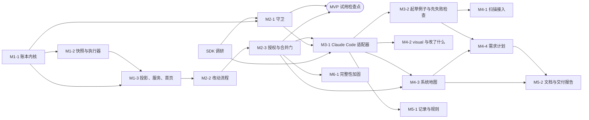

# Stagent v1 任务拆分

> 本文把 [`docs/spec.md`](spec.md)（v2.2）的 M1–M6 拆成 16 个可以**单独实现、单独验收、单独合并**的任务。
> 规格是"做什么"的唯一依据；本文只回答"按什么顺序、拆成哪几块、每块怎么算做完"。两者冲突时以规格为准，并回头修正本文。

## 0. 使用方式

- **一次只推进一个任务**（同一波次内标注了可并行的除外）。每个任务做完单独开一个 PR，你合并后再开始下一个，避免后面的任务去猜前面任务的接口。
- 每个任务的「验收」都引用规格 §13 的验收编号（#1–#25）或 §4.0 的不变量。验收没全部满足，任务就不算完成。
- 每个任务的 PR 必须附上：通过的 `check` / `test` 结果；涉及界面的附截图；涉及流程的附流程图。
- 任务完成后，如果发现规格需要改，**先改规格（单独提交），再改本文**，不要只在代码里悄悄偏离规格。
- 规模估计：**S** ≈ 半天到 1 天，**M** ≈ 1–3 天，**L** ≈ 3–5 天（AI 执行 + 你验收的总时长，仅供排期参考）。

## 1. 总览

| 编号 | 任务 | 里程碑 | 依赖 | 规模 |
|---|---|---|---|---|
| M1-1 | 项目脚手架与账本内核（事件链） | M1 | — | M |
| M1-2 | 检查快照、workTreeHash 与检查执行器 | M1 | M1-1 | L |
| M1-3 | 状态投影、本地服务、init 与首页结论卡 | M1 | M1-1、M1-2 | L |
| SDK | Claude Agent SDK 合同调研（M3 前置） | M3 前置 | — | S |
| M2-1 | 守卫：PreToolUse 拦截与危险命令规则 | M2 | M1-1、SDK | M |
| M2-2 | 改动流程：两档、互斥、外部改动识别与状态机 | M2 | M1-3 | L |
| M2-3 | 授权三段式事务与服务端合并门 | M2 | M2-2 | L |
| M3-1 | Claude Code 适配器：实现与自动修复循环 | M3 | SDK、M2-1、M2-3 | L |
| M3-2 | 起草例子、先失败检查与决策卡 | M3 | M3-1 | M |
| M4-1 | 扫描接入与基线例子 | M4 | M3-2 | M |
| M4-2 | visual 截图确认与「改了什么」视图 | M4 | M3-1 | M |
| M4-3 | 功能文件映射与系统地图 | M4 | M2-3、M3-1 | L |
| M4-4 | 需求计划 | M4 | M4-3、M3-2 | M |
| M5-1 | 记录卡、规则提案与个人通用库 | M5 | M3-1 | M |
| M5-2 | 生成文档、交付报告与健康指标 | M5 | M4-3、M4-4 | M |
| M6-1 | 完整性加固（head 锚点与恢复协议） | M6 | M2-3 | M |

> 共 16 个任务：15 个开发任务 + 1 个调研任务（SDK）。另有一个不写代码的「MVP 试用检查点」（第 4 节），不计入任务数。

### 依赖图

### 执行波次

| 波次 | 任务 | 说明 |
|---|---|---|
| 1 | M1-1 ∥ SDK 调研 | 两者互不依赖，可并行 |
| 2 | M1-2 | |
| 3 | M1-3 | 完成后可演示 M1 最小闭环 |
| 4 | M2-1 ∥ M2-2 | 守卫只依赖账本与 SDK 调研（波次 1 已完成），可与改动流程并行 |
| 5 | M2-3 | |
| ★ | **MVP 试用检查点** | 见第 4 节。在一个真实项目上用一周，再决定 M3 之后是否调整 |
| 6 | M3-1 → M3-2 | |
| 7 | M4-2 ∥ M4-3 → M4-1 → M4-4 | M4-1 依赖 M3-2，可与 M4-3 并行 |
| 8 | M5-1 ∥ M5-2 | |
| 任意 ≥ 5 | M6-1 | 在需要对外交付、需要更强的账本可信度时再做 |

---

## 2. 任务详情

每个任务按同一格式描述：**目标 / 依赖 / 范围 / 不做 / 验收 / 交付物**。「§」指 `docs/spec.md` 的章节。

### M1-1 项目脚手架与账本内核（事件链）

- **目标**：搭好工程骨架和"只追加事件账本"，后续所有任务都在它上面写事件。
- **依赖**：无。
- **范围**
  - 工程：Node 20+、TypeScript、单个 npm 包（`npx stagent` 入口）、vitest，`check`（类型检查 + lint）与 `test` 脚本；前端目录占位（§3 技术栈）。
  - 账本服务（§4.1）：`.stagent/ledger/events.jsonl` 追加写入，首行 `ledger.meta`（ledgerVersion 3）；`hash = sha256(prevHash + JCS(event))`，JCS 按 RFC 8785；启动校验规则 1、2、2a；`ledger.integrity_override`（带 `prefixSha256` / `brokenLinks`）后的链校验例外。
  - Event 与 CheckResult 等类型按 §4.1 全量写出（含 v2.2 新增事件），后续任务直接复用。
  - 账本写锁（进程内互斥），供 M2-3 的授权事务使用。
- **不做**：head 锚点、`head.tmp`、TOFU、从 git 恢复（M6-1）；任何界面。
- **验收**
  - 篡改任意一行 → 启动报告锁定（**#6**）；接受当前状态后再启动不锁定，之后再篡改其它行仍锁定。
  - 末尾半行被截掉且不锁定；ledgerVersion 不符时拒绝启动。
  - JCS 有键排序与数字序列化的测试。
- **交付物**：账本模块与单元测试。

### M1-2 检查快照、workTreeHash 与检查执行器

- **目标**：实现"证据只来自系统亲自运行的检查"。
- **依赖**：M1-1。
- **范围**
  - 锁定检查快照（§4.1）：`.stagent/ledger/snapshots/<sha256>`，`checkSnapshotId == checkHash`；启动时清理孤儿快照。
  - workTreeHash（§4.1）：文件集合、排除清单（含 `events.jsonl`）、`config.evidence.ignoreGlobs`（`.stagent/checks/**` 不可豁免）、各类型条目的 entryHash、`workTreeHashSpec`。
  - 检查执行器（§7）：`checkCommand` 模板；执行前从快照还原到 `runs/<runId>/checks/` 并重算 sha256；devServer 启动与健康检查；单个检查超时；退出码映射；run 起止四个值与 `valid=false`；failed 同轮复跑识别 `flaky`（`config.flakyRetries`）；errored 重试 1 次；`valid=false` 自动重跑一次；`purpose` 字段；写 `run.completed`。
- **不做**：Playwright 截图与 visual 例子（M4-2）；先失败检查的业务流程（M3-2，本任务只需支持 `purpose:'red_check'` 运行草稿内容）。
- **验收**
  - 快照被篡改时拒绝执行；删除工作区检查文件仍从快照执行（**#3** 执行器部分）。
  - 运行期间改工作区或提交 commit → `valid=false`（**#16** 执行器部分）。
  - 先失败后通过的检查 → `flaky`，`attempts` 两条（**#21** 执行器部分）。
  - 只改 README 不改变 workTreeHash；改锁文件会改变；改 ignoreGlobs 改变 spec（**#24** 哈希部分）。
  - 追加事件不改变 workTreeHash（**#25** 哈希部分）。
  - Invariant 3：每条 `run.completed` 都带四个起止值与快照集合。
- **交付物**：执行器模块；一个最小示例项目（vitest 检查）作为集成测试夹具，后续任务复用。

### M1-3 状态投影、本地服务、init 与首页结论卡

- **目标**：把账本和执行器连成第一个可以演示的闭环。
- **依赖**：M1-1、M1-2。
- **范围**
  - 投影（§4.2）：例子级判定表（含结果不稳定、证据过期 / 无效、仅 AI 声称）；red_check 不参与判定；功能级状态（已验证需 ≥ 1 个例子，显示「已验证（N 个例子）」）；覆盖薄弱。
  - `stagent init`（§9 第 1 步，不含扫描）：`.stagent/`、meta 行、`.gitignore`、config.json 草稿。
  - 本地服务（§3、§12）：Fastify；端口 4310 起自动递增；单实例锁 `service.lock`；`GET /api/overview`、`GET /api/features(/:id)`、`POST /api/runs`；SSE `/api/events/stream`（Last-Event-ID 续传）。
  - 前端（§11）：React + Vite，打包进 npm 包；首页结论卡（五种状态、原因按严重度排序、禁用按钮旁写原因）、拦截提醒占位、统计、功能表；空账本状态。
  - 一个**临时**的"手动添加功能与锁定例子"入口，仅用于 M1 演示，在 M2-2 中由正式流程替换。
- **不做**：改动流程、授权、详情抽屉的改动部分。
- **验收**
  - 闭环演示：锁定 → 快照 → 运行 → passed → 首页「已验证（N 个例子）」→ 改工作区 → 证据过期 → 篡改锁定检查 → 不再已验证，旧 run 仍在账本（Invariant 3、4）。
  - 不存在任何 API 能直接把功能写成已验证（**Invariant 2**），有测试。
  - **#24**、**#25** 端到端通过；**#21** 界面显示「结果不稳定」。
- **交付物**：服务与前端；首页截图。

### SDK 调研：Claude Agent SDK 合同 spike

- **目标**：按 §8 要求，在 M3 开工前把 SDK 的真实行为固化下来，不凭假设实现。
- **依赖**：无。可与 M1-1 并行。
- **范围**：确认并记录 PreToolUse hook 的输入 / 输出 schema 与 deny 返回原因的方式；permission mode（acceptEdits 等）的实际行为；工具拦截粒度（Write / Edit / MultiEdit / Bash）；会话 resume 能力；usage / cost 字段；流式事件 schema。
- **不做**：任何产品代码。
- **验收**：每一项都有可运行的验证脚本输出作证；与规格假设不符之处列出对 M2-1、M3-1 的影响。
- **交付物**：`spikes/agent-sdk/` 最小脚本；结论回填 `docs/spec.md` §8（注明 SDK 版本与验证日期）；必要时同步修改本文的 M2-1 / M3-1。

### M2-1 守卫：PreToolUse 拦截与危险命令规则

- **目标**：Claude Code 写锁定路径或执行危险命令时被当场拒绝。
- **依赖**：M1-1（写 `guard.blocked`）、SDK 调研（hook 的输入 / 输出格式与 deny 方式以调研结论为准）。
- **范围**（§6）
  - `stagent init` 写入 `.claude/settings.json` 的 PreToolUse hook：`stagent hook pre-tool-use`。
  - CLI 读 stdin 的工具调用：Write / Edit / MultiEdit 目标在 `.stagent/**` 或锁定检查路径 → deny；`.stagent/checks/draft/**` 仅在「确认例子」阶段的起草会话中放行。
  - Bash 危险命令规则（附录 B），可由 `config.guard.bashRules` 扩展。
  - 命中时写 `guard.blocked` 并给出原因；首页拦截提醒显示最近一条。
  - `.git/hooks/pre-merge-commit` 提醒脚本（可关闭，仅提醒）。
- **不做**：合并门（M2-3）。
- **验收**：Claude Code 尝试改锁定检查被拒绝，界面出现拦截提醒，账本有 `guard.blocked`（**#2**）；附录 B 每条规则有正反例测试。
- **交付物**：hook CLI、规则模块与测试。

### M2-2 改动流程：两档、互斥、外部改动识别与状态机

- **目标**：建立"改动"这个核心对象和它的状态机，此时先不接 AI，用手动或外部编辑驱动。
- **依赖**：M1-3。
- **范围**
  - 存放形态与互斥（§5.0）：`POST /api/changes`，有进行中改动时 409。
  - 两档流程骨架（§5.1、§5.2）：小改动 / 新功能；升档、降档（`POST /api/changes/:id/track`）。
  - 状态机（§5.4）：确认例子 → 先失败检查 → 实现中 → 检查中 → 被阻止 / 待你确认外观 / 可合并；状态只由服务端从事件推导。
  - 外部改动（§5.3）：chokidar 监听、防抖 2 秒、归属规则、`firstObservedWorkTreeHash`；HEAD 前进但无 `change.merged` → 标注 unmanaged commit 并补跑回归。
  - 详情抽屉（§11）：档位、进度条、证据区；被阻止原因。
  - 用正式流程替换 M1-3 的临时锁定入口。
- **不做**：授权与合并（M2-3）；AI 起草与实现（M3）。状态机中的「先失败检查」只定义状态与转换（可用测试事件驱动），`red-check` / `red-waive` 端点和决策卡属于 M3-2。
- **验收**：升档 / 降档事件完整（**#13**）；互斥 409 且外部变更并入当前改动（**#14**）；直接 `git commit` 后标注 unmanaged commit 并补跑回归（**#15**）；破坏已验收例子时结论卡显示不能合并并点名功能（**#4** 的检测部分）。
- **交付物**：改动编排器、文件监听、抽屉界面；状态机流程图。

### M2-3 授权三段式事务与服务端合并门

- **目标**：所有不可逆动作都经过授权，所有来源的合并都经过服务端合并门（唯一强制边界）。
- **依赖**：M2-2。
- **范围**（§6）
  - `POST /api/auth`；授权一次性；按 changeId 串行化；三段式：`auth.consumed`（先于副作用）→ 副作用 → 结果事件 + `auth.settled`。
  - 合并门：重算全部快照哈希 + 校验事件链；通过后 `git add -A` + commit，写 `change.merged`（含 `files` 清单，供 M4-3 使用）。
  - merge / merge_override（一次授权即合并）/ abandon（先返回受影响文件清单供确认，从「实现中」或「被阻止」均可发起）/ modify_locked（解锁 → 改 → 重锁 → 自动回归）/ delete（功能退役、记录删除）/ release（运行配置的发布命令）。
  - 原因校验：除 merge 外必填且 ≥ 4 个字符。
  - 失败补偿：副作用失败、悬挂消费（启动时列出、不自动重试）。
  - 抽屉的「授权」区块与合并按钮。
- **不做**：budget_raise 的触发（M3-1，本任务只需支持该授权类型）。
- **验收**：Cursor 改锁定检查后合并按钮禁用并显示「锁定检查被修改」（**#3** 合并门部分）；强行合并必须填原因，原因进入决策记录（**#9**）；并发两笔 merge 仅一笔消费，账本恰好一条 `auth.consumed`（**#17**）；release 在消费后、执行前崩溃 → 重启后不再执行（**#19**）；`--no-verify` 绕过后仍需经过合并门（**Invariant 5**）；**Invariant 6** 有测试。
- **交付物**：授权与合并门模块；授权流程图。

### MVP 试用检查点（非开发任务）

见第 4 节。

### M3-1 Claude Code 适配器：实现与自动修复循环

- **目标**：Stagent 能驱动 Claude Code 完成实现与修复，且 AI 的回报永远只是"声称"。
- **依赖**：SDK 调研、M2-1、M2-3。
- **范围**（§8）
  - `AgentExecutor` 接口（含 v2.2 的 `draftPlan`、`attributeFiles` 签名，实现留给 M4）；Claude Code 实现：`query()`、cwd、acceptEdits、hooks 生效。
  - 实现与修复提示（附锁定例子、项目规则、上轮失败日志）；回报解析为 `claim.reported`，解析失败标「回报格式异常」。
  - 自动修复最多 3 轮，超过后给出「继续修复 / 放弃改动 / 授权强行合并」。
  - 小改动档的 AI 档位判断。
  - 费用：记录 usage；达到 `config.budget.perChange` / `perDay` 时暂停并发起 `budget_raise` 授权。
  - SSE 进度：一行状态 + 可展开日志。
  - 服务重启时进行中改动标「实现中断」，按 SDK 调研结论续接或重新发起。
  - Claude Code 未安装 / 未登录时的禁用与提示。
- **不做**：起草例子与先失败检查（M3-2）。
- **验收**：AI 回报"已实现"但检查 errored → 显示「仅 AI 声称」而非通过；claim 与 failed 并存时显示失败且 claim 保留（**#5**，**Invariant 1**）；改坏后修复变为可合并（**#4** 修复部分）；小改动从描述到可合并不需要人工确认（**#10**）。
- **交付物**：适配器模块；用 SDK 的录制回放或桩做的测试（不依赖真实调用跑 CI）。

### M3-2 起草例子、先失败检查与决策卡

- **目标**：新功能档完整可用，且空检查无法被锁定。
- **依赖**：M3-1。
- **范围**
  - 起草例子（§8）：只写 `.stagent/checks/draft/`；每条检查附大白话摘要。
  - 先失败检查（§5.1）：`POST /api/changes/:id/red-check`；只有 failed 合格；不合格的决策卡：重写 / 确认行为已存在（`red-waive`，必填原因）/ 删除；锁定时校验 `checkHash` 一致（否则 422）。
  - 锁定：`POST /api/changes/:id/examples/lock` 写快照与 `example.locked.redCheck`。
  - 决策卡组件（§11、D17）：问题、背景、2–3 个选项带利弊和推荐标签；「我有疑问」对话（`POST /api/decisions/:cardId/ask`）。
- **验收**：未实现时就通过的检查不能锁定，豁免原因可查（**#20**，**Invariant 7**）；先失败检查的 run 不让任何功能变成被破坏。
- **交付物**：起草与先失败检查流程；决策卡截图；新功能档流程图。

### M4-1 扫描接入与基线例子

- **目标**：已有项目可以接入。
- **依赖**：M3-2。
- **范围**（§9）：「扫描功能」只读扫描，`feature.created(origin:'scan', entryFiles)`；勾选 3–5 个核心功能起草基线例子（草稿可自由修改）；基线运行（`purpose:'baseline'`，不做先失败检查）；基线失败的三个选项（改例子 / 新建改动修复 / 接受现状并标「已知不一致」）；功能退役入口；「尚无例子」「补例子」入口；技术栈检测写入 config 草稿。
- **验收**：示例 Next.js 项目（≤ 200 个源文件）上 init + 扫描，30 秒内开始流式返回功能清单，锁定 3 个基线例子后能跑出结果（**#1**）。
- **交付物**：接入流程与截图；示例项目作为测试夹具。

### M4-2 visual 截图确认与「改了什么」视图

- **目标**：外观类例子由你确认；每个改动都能用大白话看懂改了什么。
- **依赖**：M3-1。
- **范围**
  - visual 例子（§7）：Playwright 截图存 `runs/<id>/`；抽屉中确认 → `visual.confirmed`；不满意回到实现（不计入 3 轮上限）；状态机「待你确认外观」。
  - 「改了什么」（§11、D20）：基准 → 工作区、文件数与增删行数、来源；按功能的大白话说明；改前改后截图；可展开 diff。（「触及的功能」与「超出本功能的改动」区块由 M4-3 填充。）
  - 开发服务器起不来时的 errored 与「修改启动命令」。
- **验收**：有 visual 例子的改动在全部通过后进入「待你确认外观」，确认后才可合并；拒绝后回到实现中，事件完整。
- **交付物**：截图确认与改动视图的截图。

### M4-3 功能文件映射与系统地图

- **目标**：回答"这个功能由哪些文件承载、这次改动碰了哪些功能、坏了该看哪"。
- **依赖**：M2-3（`change.merged.files`）、M3-1（`attributeFiles`）。
- **范围**（§4.5、§11）
  - 映射投影：扫描入口文件 → 合并归属 → 手动纠正；删除 / 重命名处理；共享热点（≥ 3 个功能）；未归属。
  - 归属产生：新功能档按目标功能；其余由 AI 提出并自动采用；`change.files_attributed`、`PUT /api/changes/:id/attributions`、`POST /api/map/files`。
  - `targetFeatureIds`（小改动由 AI 给出）；「触及的功能」「超出本功能的改动」区块；被破坏功能的「可能相关的改动文件」，并传给修复提示。
  - 系统地图页与 `GET /api/map`、`/api/map/files?path=`；页首声明"来自改动历史，不是依赖分析"。
- **验收**：**#22** 全部场景；映射错误不改变任何证据状态（**Invariant 8**，有测试）。
- **交付物**：映射模块、系统地图页截图、影响提示截图。

### M4-4 需求计划

- **目标**：大需求先拆成你确认过的有序步骤，再逐步执行。
- **依赖**：M4-3（用系统地图起草计划）、M3-2。
- **范围**（§4.4、§5.5）：`POST /api/changes` 返回 `suggestPlan`；`draftPlan`；`plan.drafted / confirmed / revised / closed`；步骤状态推导（等待前置 / 可开始 / 进行中 / 已完成 / 待重做）；「开始这一步」创建带 `planId/stepId` 的改动；已完成步骤不可删改；同时最多一个进行中计划；计划页与结论卡下的计划进度行。
- **验收**：**#23** 全部场景；计划进行中时改动互斥规则不变。
- **交付物**：计划页截图；计划流程图。

### M5-1 记录卡、规则提案与个人通用库

- **目标**：重复踩的坑变成带失效条件的规则，写进 CLAUDE.md 与 Cursor 规则。
- **依赖**：M3-1。
- **范围**（§10）：合并后 AI 起草 0–2 条记录卡；同标签 pitfall 达 2 条时出规则提案；确认后写入 CLAUDE.md 与 `.cursor/rules/stagent.mdc` 的 `<!-- stagent:rules -->` 区块；启动时校验区块偏离与「以账本为准重新生成」（`POST /api/rules/regenerate`）；规则效果度量与退役提示；个人通用库（`~/.stagent/library/`）与新项目接入时按技术栈挑选。
- **验收**：**#11**。
- **交付物**：记录与规则页截图。

### M5-2 生成文档、交付报告与健康指标

- **目标**：给你和 AI 读的"系统说明书"，以及给客户的一页式交付报告。
- **依赖**：M4-3、M4-4（报告需要地图与计划数据）。
- **范围**
  - 文档生成器（§10）：`features.md`、`system-map.md`、`plan.md`、`rules.md`，相关事件后重新生成。
  - 交付报告（§11、D26）：版本四元组；功能与例子原文、最近验证时间与结果（「已验证（N 个例子）」）、先失败检查结果或豁免原因、主要文件；账本完整性一栏（M6 前如实写「仅校验链内一致性」）；计划；全部授权放行记录（merge 标「免填原因」）；`integrity_override` 显式标注；未验证项（含已知不一致、结果不稳定）；HTML 与 PDF，缺 Chromium 时降级为 HTML 并注明。
  - 健康指标埋点（§14）：写 `~/.stagent/metrics.jsonl`。
- **验收**：**#12**；报告中"仅 AI 声称"条目明确标出，不出现任何不来自账本投影的内容。
- **交付物**：示例报告（HTML 与 PDF）。

### M6-1 完整性加固（head 锚点与恢复协议）

- **目标**：能识别"有人整本重写账本"，并处理崩溃与新机器场景。
- **依赖**：M2-3（授权事务与账本写入路径稳定后再改追加协议）。
- **范围**（§4.1 标注 M6 的部分）：`~/.stagent/projects/<id>/head`；`head.tmp` 原子写入协议；启动规则 3–7；`ledger.head_recovered`、`ledger.trust_established`（TOFU 确认卡）、`ledger.restored`（从 git 历史恢复）；`POST /api/ledger/recover` 的 `from_git` / `establish_trust`；交付报告完整性一栏改为「已启用外部锚点」。
- **验收**：**#7**、**#8**、**#18**（含对照实验）。
- **交付物**：恢复流程图；各错误状态截图。

---

## 3. 覆盖核对

### 验收标准（spec §13）

| 验收 | 主任务 | 协同 |
|---|---|---|
| #1 init + 扫描 | M4-1 | M1-3 |
| #2 守卫拦截 | M2-1 | |
| #3 锁定检查被改 | M2-3 | M1-2 |
| #4 破坏已验收例子 | M2-2 | M3-1 |
| #5 仅 AI 声称 | M3-1 | M1-3 |
| #6 篡改账本 | M1-1 | |
| #7 TOFU | M6-1 | |
| #8 崩溃恢复 | M6-1 | |
| #9 强行合并原因 | M2-3 | M5-2（报告） |
| #10 小改动无需确认 | M3-1 | M2-2 |
| #11 规则提案 | M5-1 | |
| #12 交付报告 | M5-2 | |
| #13 升降档 | M2-2 | |
| #14 互斥 | M2-2 | |
| #15 unmanaged commit | M2-2 | |
| #16 run 一致性 | M1-2 | M1-3 |
| #17 授权并发 | M2-3 | |
| #18 追加攻击 | M6-1 | |
| #19 放弃与发布事务性 | M2-3 | |
| #20 先失败检查 | M3-2 | |
| #21 不稳定检查 | M1-2 | M1-3 |
| #22 系统地图 | M4-3 | |
| #23 需求计划 | M4-4 | |
| #24 证据失效豁免 | M1-2 | M1-3 |
| #25 账本自身不使证据过期 | M1-2 | M1-3 |

### 核心不变量（spec §4.0）

| 不变量 | 首次建立 | 之后每个任务都不得破坏 |
|---|---|---|
| 1 claim 不能产生已验证 | M3-1 | ✅ |
| 2 无 API 可直接写已验证 | M1-3 | ✅ |
| 3 已验证可追溯到有效 run | M1-2 | ✅ |
| 4 改锁定检查后旧 run 不再作证 | M1-3（投影）、M2-3（modify_locked） | ✅ |
| 5 所有合并经过合并门 | M2-3 | ✅ |
| 6 授权三段式 | M2-3 | ✅ |
| 7 空检查不能锁定 | M3-2 | ✅ |
| 8 映射不参与证据 | M4-3 | ✅ |

建议从 M1-3 起，把已建立的不变量写成一组专门的回归测试（例如 `test/invariants/`），每个任务的 PR 都必须让这组测试保持通过。

## 4. MVP 试用检查点

M2-3 合并后暂停开发，在你自己的一个真实项目上用 Stagent 约一周：

- 用 Cursor 或手写检查锁定 3–5 个核心功能（此时还没有 AI 起草，正好检验检查执行器与合并门本身）；
- 照常用 Cursor / Claude Code 开发，观察：合并门拦住了几次真问题、误报几次、「证据过期」和「结果不稳定」是否让人烦；
- 把观察写成一条记录，据此决定 M3 之后的优先级（例如系统地图是否要提前到 M3 之前）。

这一步的产出是"是否调整计划"的结论，可能会修改本文和规格；不是代码。

## 5. 风险与应对（与拆分相关）

- **接口在前面任务里定得不对**：M1-1 一次性写全事件类型，就是为了让后续任务不改事件格式。确需改时，先改规格并升级 ledgerVersion。
- **SDK 行为与规格假设不符**：SDK 调研必须在 M2-1、M3-1 开工前完成；结论可能改写这两个任务的范围。
- **任务过大**：M1-2、M1-3、M2-2、M2-3、M3-1、M4-3 标为 L。若单个 PR 超过约 1500 行（不含测试与夹具），拆成两个 PR 依次合并，任务本身不变。
